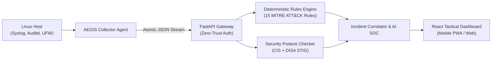

# 🛡️ AEGIS — Zero-Trust Linux Security Monitoring & Defense Platform

<div align="center">


**AI-Powered Linux Security Monitoring • MITRE ATT&CK Threat Detection • CIS & DISA STIG Audit • Hard Multi-Tenancy**

[-brightgreen.svg?style=for-the-badge&logo=pytest)](tests/)
[](aegis_backend/tenancy.py)
[](aegis_agent/security_checker.py)
[](docker-compose.yml)
[](dashboard/public/manifest.webmanifest)

</div>

---

## 📌 Apa Itu AEGIS?

**AEGIS** adalah platform pertahanan dan pemantauan keamanan server Linux (*Ubuntu 22.04 / 24.04 LTS*) yang dirancang khusus untuk lingkungan berkeamanan tinggi. Platform ini menggabungkan:
1. **Deteksi Ancaman Deterministik** berbasis 15 taktik & teknik MITRE ATT&CK.
2. **Audit Kepatuhan Ketat** berbasis standar **CIS Benchmark** dan standar pertahanan militer **DISA STIG**.
3. **Pemisahan Satuan / Organisasi Absolut (Hard Multi-Tenancy Zero-Trust)** agar data antar divisi tidak saling bocor.
4. **Analisis Insiden Forensik Berbantuan AI** untuk mempermudah investigasi tim operator SOC.
5. **Filosofi Zero Autonomous Remediation**: AEGIS **tidak pernah** mematikan layanan atau memodifikasi konfigurasi server secara sembarangan—seluruh kendali perbaikan tetap berada di tangan operator manusia.

---

## ⚡ Panduan Instalasi Cepat (Rekomendasi Utama)

> [!TIP]
> **Gunakan Docker Compose.** Ini adalah metode paling mudah, stabil, dan otomatis untuk menjalankan seluruh ekosistem AEGIS (Backend + Dashboard Web) hanya dalam 1 perintah.

### Langkah 1: Siapkan Konfigurasi
Buka terminal di folder proyek AEGIS, lalu salin file environment:
```bash
# Salin konfigurasi environment
cp .env.example .env
```
*(Opsional: Masukkan API Key Gemini/AI pada file `.env` jika ingin mengaktifkan fitur investigasi cerdas).*

### Langkah 2: Jalankan Platform
Cukup jalankan satu perintah berikut:
```bash
docker compose up -d --build
```
Docker akan otomatis mengompilasi dan menyalakan seluruh sistem di latar belakang.

### Langkah 3: Buka Dashboard & Mulai Eksplorasi
Buka browser dan kunjungi:
👉 **[http://localhost:1708](http://localhost:1708)** *(Dashboard UI Utama)*

Gunakan salah satu akun bawaan berikut untuk login:

| Akun / Satuan | Username | Password | Hak Akses (Role) |
| :--- | :--- | :--- | :--- |
| **Pusat Komando (HQ)** | `admin` | `Aegis@CommandHQ2026!` | **Superadmin** (Bisa melihat seluruh server dari semua unit) |
| **Unit Alpha** | `operator_alpha` | `Alpha@Aegis2026!` | **Engineer** (Hanya melihat server milik Unit Alpha) |
| **Unit Bravo** | `operator_bravo` | `Bravo@Aegis2026!` | **Engineer** (Hanya melihat server milik Unit Bravo) |

---

## 🖥️ Memasang Agen di Server Linux Nyata (Opsional)

Jika Anda memiliki server Linux fisik / VM Ubuntu nyata yang ingin dipantau oleh AEGIS, cukup jalankan **1 baris perintah installer otomatis** di server target:

```bash
sudo bash scripts/install_agent.sh \
  --server-url http://<IP_KOMPUTER_AEGIS>:1709 \
  --tenant-id unit_alpha \
  --auth-token aegis_agt_6_GULjT3yz20fgkK3ocCzZfqxTslOxN-lVRCNbNTWSM
```
*Installer ini otomatis membuat virtual environment terisolasi di `/opt/aegis-agent`, mengunci hak akses file (chmod 600), dan mendaftarkannya sebagai background daemon systemd (`aegis-collector.service`).*

* **Cek status agen**: `sudo systemctl status aegis-collector`
* **Copot agen jika selesai**: `sudo bash scripts/uninstall_agent.sh`

---

## 🛠️ Alternatif: Menjalankan Tanpa Docker (Local Development)

Jika Anda ingin mengubah kode (*coding*) atau menguji modul secara lokal tanpa Docker:

<details>
<summary><b>Klik di sini untuk melihat langkah instalasi manual (Python + Node.js)</b></summary>

```bash
# 1. Jalankan Backend (Terminal 1)
python -m venv venv
# Windows: .\venv\Scripts\activate | Linux: source venv/bin/activate
pip install -r requirements.txt
python -m uvicorn aegis_backend.main:app --host 127.0.0.1 --port 1709 --reload

# 2. Jalankan Dashboard Frontend (Terminal 2)
cd dashboard
npm install
npm run dev
# Buka di: http://localhost:1708
```
</details>

---

## 🎯 Fitur & Kemampuan Inti AEGIS



### 1. 🛡️ Hard Multi-Tenant Isolation (Zero-Trust)
* **Server-Side Enforcement**: Pemisahan data diterapkan di level database repository (`TenantScopedRepository`), bukan sekadar filter UI.
* **Anti-Enumeration 404**: Jika operator Unit Alpha mencoba mengintip URL server Unit Bravo, sistem merespons **404 Not Found** (bukan 403), sehingga attacker tidak bisa memetakan aset rahasia.
* **Host Anti-Spoofing**: Host terikat secara kriptografis ke tenant saat pertama kali mengirim telemetri.
* **Brute-Force Shield**: Kunci akun sementara jika ada percobaan login salah $\ge 5$ kali.

### 2. ⚡ 15 Aturan Deteksi Deterministik MITRE ATT&CK
Deteksi ancaman berlangsung instan (sub-milidetik) tanpa ketergantungan koneksi internet:
* `RULE-SSH-BRUTE` (`T1110.001`) — Serangan brute force password SSH.
* `RULE-SSH-SPRAY` (`T1110.003`) — Password spraying lintas banyak akun.
* `RULE-ROOT-LOGIN` (`T1078.003`) — Login langsung akun root via SSH.
* `RULE-SUDO-ABUSE` (`T1548.003`) — Kegagalan autentikasi sudo berulang.
* `RULE-SUDO-ESCALATION` (`T1548.003`) — Eskalasi hak akses mencurigakan (`chmod 777`, interactive shell).
* `RULE-USER-BACKDOOR` (`T1136.001`) — Pembuatan akun backdoor baru berkode `UID 0`.
* `RULE-PORT-SCAN` (`T1046`) — Pemindaian port jaringan agresif.
* `RULE-KERNEL-EXPLOIT` (`T1068`) — Deteksi crash memori / Segfault exploit.
* `RULE-CRON-PERSIST` (`T1053.003`) — Pemasangan backdoor persistence di Cron job.
* `RULE-DEFENSE-EVASION` (`T1562.001`) — Percobaan mematikan service keamanan (`ufw`, `auditd`, `ssh`).
* `RULE-WEB-PROBES` (`T1190`) — Serangan Web (SQL Injection, Path Traversal, Command Injection).
* `RULE-SSH-KEY-BACKDOOR` (`T1098.004`) — Modifikasi ilegal pada file `authorized_keys`.
* `RULE-ANTI-FORENSICS` (`T1070`) — Penghapusan jejak log (`history -c`, `shred`, `rm -rf /var/log`).
* `RULE-DATA-EXFIL` (`T1041`) — Pengarsipan dan eksfiltrasi data rahasia (`tar`, `scp`, `curl -F`).
* `RULE-ROOTKIT-SNIFF` (`T1547.006`) — Injeksi modul kernel tidak sah (`insmod`) & packet sniffing.

### 3. 🎖️ 12 Modul Audit Postur Keamanan (CIS Benchmark + DISA STIG)
* **8 Kontrol CIS Ubuntu**: `PermitRootLogin`, izin file `/etc/shadow`, audit `NOPASSWD` sudoers, deteksi binary SUID berbahaya, audit port terbuka UFW, parameter proteksi kernel ASLR, pembaruan patch keamanan, dan integritas cron job.
* **4 Kontrol Militer DISA STIG**: Banner peringatan hukum militer (`STIG-BANNER-8.1`), algoritma enkripsi FIPS SSH (`STIG-CRYPTO-5.2`), imutabilitas log kernel (`STIG-AUDIT-4.1`), dan blacklist modul USB flashdisk (`STIG-MEDIA-1.1`).

### 4. 🤖 AI Incident Investigation & PDF Reporting
* **Forensic Grounding**: AI dilarang berasumsi; kesimpulan wajib mengutip bukti otentik log mentah (*citation-backed*).
* **Multi-Role AI Keys**: Alokasi kuota cerdas dengan failover otomatis (`AEGIS1` untuk monitor, `AEGIS2` untuk audit kepatuhan, `AEGIS3` untuk pembuatan laporan PDF eksekutif).
* **Offline Fallback**: Jika internet mati, platform tetap berfungsi 100% menggunakan mesin analisis lokal berbasis aturan.

---

## 📈 Efisiensi Memori (Ultra-Low RAM Footprint)

AEGIS dirancang agar dapat berjalan lancar bahkan pada komputer mini / Raspberry Pi / VPS berspesifikasi rendah:

| Komponen Sistem | Teknologi | RAM Saat Idle | RAM Saat Beban Penuh | Alokasi Maksimal |
| :--- | :--- | :---: | :---: | :---: |
| **Backend API** | FastAPI + Python 3.12 | **~60 MB** | **~95 MB** | `192 MB` |
| **Dashboard UI** | Nginx Alpine + SPA | **~10 MB** | **~18 MB** | `64 MB` |
| **Agent Collector** | Python Native Daemon | **~18 MB** | **~25 MB** | `48 MB` |
| **TOTAL SISTEM** | **Full Stack Aktif** | **< 90 MB** | **< 135 MB** | **256 MB** |

---

## 👥 Tim Pengembang & Kontributor

Proyek AEGIS dirancang dan dikembangkan dengan bangga oleh:

<div align="center">

| Kontributor | Peran & Tanggung Jawab Utama | Fokus Kontribusi |
| :---: | :---: | :--- |
| **Fendy Ramadhani**<br/>`@fendyramadhani9` | **Project Lead & Security Architect** | • Arsitektur Zero-Trust & Hard Multi-Tenancy<br/>• Sistem Autentikasi JWT & Anti-Brute Force<br/>• Integrasi End-to-End & Full-Stack Hardening<br/>• Manajemen Database Hybrid SSoT & Keamanan Host |
| **Yazz**<br/>`Core Contributor` | **AI & Detection Engine Specialist** | • Mesin Deteksi Deterministik 15 MITRE ATT&CK<br/>• Pipeline Forensik & Investigasi Insiden AI<br/>• Arsitektur 3-Key Failover Provider (`AEGIS1..3`)<br/>• Prompt Guardrails & Sanitasi Data Sensitif |
| **Apri**<br/>`Core Contributor` | **DevOps & Security Compliance Engineer** | • Audit Postur Kepatuhan CIS Benchmark + DISA STIG<br/>• 1-Click Systemd Linux Agent Installer<br/>• Optimasi Kontainer Docker Ultra-Low RAM Footprint<br/>• Harness Pengujian Kualitas & Validasi Regresi |

</div>

---

## 🧪 Jaminan Kualitas & Pengujian Regresi

AEGIS menerapkan standar rekayasa perangkat lunak pertahanan dengan pengujian menyeluruh:

* **256 Unit & Integration Tests**: 100% Passed (`python -m pytest tests/`).
* **Frontend Type-Safety**: 0 Error TypeScript (`tsc -b && vite build`).
* **Hasil Security Audit Tuntas**: Seluruh 35 temuan bug fungsional dan celah keamanan telah diperbaiki dan diverifikasi. Laporan lengkap pengujian tercatat di [BUG_FIX_REPORT.md](BUG_FIX_REPORT.md).

```bash
# Menjalankan seluruh test suite lokal:
python -m pytest tests/ -v
```

---

## 📁 Struktur Direktori Utama

```text
aegis/
├── aegis_backend/           # FastAPI Core, Gateway, State Machine & Routers
│   ├── tenancy.py           # Isolasi Multi-Tenant, RBAC & Token Auth Store
│   ├── repository.py        # Abstraksi Basis Data SSoT (PostgreSQL / SQLite)
│   ├── rules_engine.py      # Mesin Deteksi 15 Aturan MITRE ATT&CK
│   └── sanitizer.py         # Pembersih Kredensial & Redaksi Password Otomatis
├── aegis_agent/             # Agen Pemantau Host Linux
│   ├── collector.py         # Syslog, Auditd, UFW Stream Collector
│   └── security_checker.py  # 12 Modul Audit Postur CIS + DISA STIG
├── dashboard/               # Antarmuka Pengguna React 18 + TypeScript + Vite
│   ├── public/              # Brand Assets, Web App Manifest & Service Worker PWA
│   └── src/                 # Layar Operasional, Sidebar, Dark Mode Tokens
├── scripts/                 # Skrip CLI Administrasi & Installer
│   ├── install_agent.sh     # 1-Click Systemd Host Agent Installer
│   └── manage_auth.py       # CLI Manajemen Pengguna, Tenant & Rotasi Token
├── tests/                   # 256 Automated Regression & Security Test Suites
├── docker-compose.yml       # Konfigurasi Deployment Produksi 1-Click
└── BUG_FIX_REPORT.md        # Laporan Verifikasi 35 Bug & Audit Keamanan
```

---

<div align="center">
<b>AEGIS Defense Platform • Built with Zero-Trust Discipline • 2026</b>
</div>
