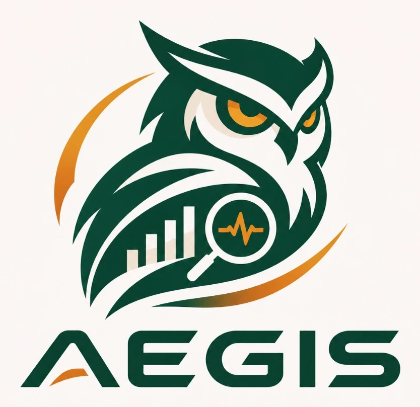
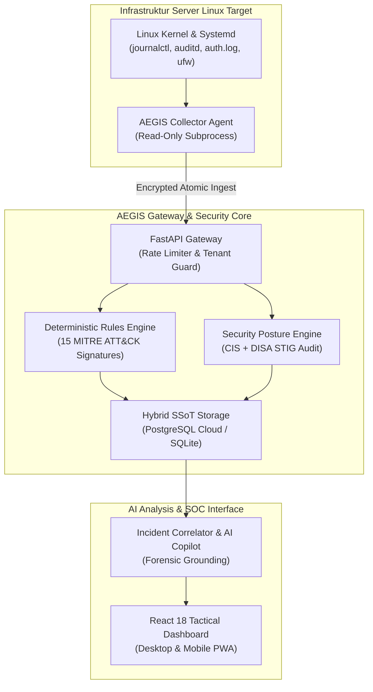

# AEGIS — Enterprise Linux Security Monitoring & Zero-Trust Defense Platform

<div align="center">



### Real-Time Linux Threat Detection • MITRE ATT&CK • CIS & DISA STIG • Hard Multi-Tenancy

[-brightgreen.svg?style=for-the-badge&logo=pytest&logoColor=white)](tests/)
[](aegis_backend/tenancy.py)
[](aegis_agent/security_checker.py)
[](docker-compose.yml)
[](dashboard/public/manifest.webmanifest)

</div>

---

## Ikhtisar Sistem

**AEGIS** adalah platform pemantauan keamanan dan investigasi forensik tingkat enterprise untuk server Linux (*Ubuntu 22.04 / 24.04 LTS*) yang dirancang khusus untuk infrastruktur berkeamanan tinggi. Platform ini menggabungkan mesin korelasi ancaman deterministik, audit kepatuhan postur keamanan militer (**CIS Benchmark & DISA STIG**), serta analisis insiden berbantuan AI.

### Filosofi Operasional: Zero Autonomous Remediation
Pada infrastruktur misi-kritis (perbankan, pertahanan, energi, pemerintahan), **tindakan pemblokiran otomatis yang gegabah (*autonomous remediation*) berisiko tinggi melumpuhkan layanan operasional**. 

AEGIS menganut filosofi **100% Read-Only & Non-Destructive**:
* Agen pengawas **tidak memiliki izin** mematikan proses, mengubah firewall, atau mengubah konfigurasi server secara sepihak.
* Seluruh panduan mitigasi disajikan secara terstruktur kepada operator manusia lengkap dengan estimasi dampak layanan (*service impact*), perintah verifikasi, serta langkah *rollback* terdokumentasi.

---

## Panduan Instalasi & Deployment Produksi

Deployment AEGIS dirancang cepat, tangguh, dan otomatis menggunakan Docker Compose.

### 1. Persiapan Environment
Salin template konfigurasi lingkungan produksi:
```bash
cp .env.example .env
```
*(Opsional: Konfigurasikan API Key AI pada file `.env` jika mengaktifkan modul investigasi otomatis).*

### 2. Jalankan Layanan
Eksekusi perintah orkestrasi kontainer:
```bash
docker compose up -d --build
```
Sistem akan mengompilasi backend FastAPI, engine deteksi, dan antarmuka web dashboard dalam isolasi kontainer mandiri.

### 3. Akses Antarmuka & Inisialisasi Akses
Setelah kontainer aktif, akses portal pengawasan:
* **Tactical Web Dashboard:** `http://localhost:1708`
* **Backend API Gateway & Docs:** `http://localhost:1708/docs` (atau langsung di port internal `1709`)

#### Manajemen Akun & Autentikasi
Untuk deployment awal, akun administrator default telah terdaftar secara terisolasi:
* **Username:** `admin`
* **Default Password:** `Aegis@CommandHQ2026!`
* **Tingkat Akses (Role):** `superadmin` *(Akses penuh Pusat Komando / HQ)*

> [!IMPORTANT]
> **Pemberitahuan Keamanan Produksi:**  
> Untuk deployment pada server publik, segera ganti password default atau tambahkan operator baru sesuai divisi operasional menggunakan CLI administrasi:
> ```bash
> # Menambahkan operator divisi (misal: Sektor Alpha)
> python scripts/manage_auth.py add-user operator_alpha "PasswordKuatBaru123!" --tenant unit_alpha --role engineer
>
> # Mengubah password akun admin
> python scripts/manage_auth.py reset-password admin "PasswordBaruHQ2026!"
> ```

---

## Pemasangan Agen pada Host Linux Target (Opsional)

Untuk memantau server fisik atau VM Ubuntu nyata, pasang agen pengumpul telemetri (*Collector Daemon*) menggunakan installer resmi:

```bash
sudo bash scripts/install_agent.sh \
  --server-url http://<IP_SERVER_AEGIS>:1709 \
  --tenant-id unit_alpha \
  --auth-token <TOKEN_AGENT_TENANT>
```

**Karakteristik Agen Host:**
* Berjalan sebagai daemon systemd terisolasi (`/etc/systemd/system/aegis-collector.service`).
* Virtual environment independen di `/opt/aegis-agent` dengan hak akses ketat (`chmod 600`).
* Konsumsi CPU rata-rata `< 0.8%` dan konsumsi RAM `< 25 MB`.
* **Cek Status Agen:** `sudo systemctl status aegis-collector`
* **Uninstall Agen Bersih:** `sudo bash scripts/uninstall_agent.sh`

---

## Arsitektur Arus Data & Pipeline Keamanan



---

## Fitur & Keunggulan Utama

### 1. Hard Multi-Tenancy & Isolasi Zero-Trust
Memastikan pemisahan data absolut antar divisi, unit kerja, atau anak perusahaan:
* **Server-Side Enforcement**: Validasi kepemilikan host diterapkan langsung di lapisan database (`TenantScopedRepository`), bukan sekadar filter visual.
* **Anti-Enumeration 404**: Jika operator Unit A mencoba membuka URL server Unit B, sistem merespons **404 Not Found** (bukan 403), menggagalkan upaya pemetaan infrastruktur rahasia.
* **Agent Anti-Spoofing**: Host terikat secara permanen pada tenant saat pengiriman telemetri pertama (*first-claim locking*).
* **Brute-Force Rate Limiting**: Penguncian otomatis sesi jika terjadi $\ge 5$ kali kegagalan autentikasi berturut-turut.

### 2. Mesin Deteksi Deterministik MITRE ATT&CK (15 Aturan Inti)
Mendeteksi serangan secara instan (sub-milidetik) tanpa latensi model AI:
* `RULE-SSH-BRUTE` (`T1110.001`) — Serangan brute force password SSH.
* `RULE-SSH-SPRAY` (`T1110.003`) — Password spraying lintas ragam akun pengguna.
* `RULE-ROOT-LOGIN` (`T1078.003`) — Percobaan login SSH langsung ke akun root.
* `RULE-SUDO-ABUSE` (`T1548.003`) — Kegagalan otentikasi perintah sudo berulang.
* `RULE-SUDO-ESCALATION` (`T1548.003`) — Eskalasi hak akses mencurigakan (`chmod 777`, shell interaktif root).
* `RULE-USER-BACKDOOR` (`T1136.001`) — Pembuatan akun pengguna tersembunyi ber-UID 0.
* `RULE-PORT-SCAN` (`T1046`) — Pemindaian port jaringan agresif pada host.
* `RULE-KERNEL-EXPLOIT` (`T1068`) — Deteksi crash memori kernel / eksploitasi Segmentation Fault.
* `RULE-CRON-PERSIST` (`T1053.003`) — Injeksi backdoor persistensi melalui Cron Job.
* `RULE-DEFENSE-EVASION` (`T1562.001`) — Percobaan mematikan service keamanan (`ufw`, `auditd`, `ssh`).
* `RULE-WEB-PROBES` (`T1190`) — Eksploitasi web server (SQLi, Directory Traversal, Command Injection).
* `RULE-SSH-KEY-BACKDOOR` (`T1098.004`) — Modifikasi tidak sah pada `authorized_keys` atau `/etc/sudoers`.
* `RULE-ANTI-FORENSICS` (`T1070`) — Pembersihan jejak log sistem (`history -c`, `shred`, `rm -rf /var/log`).
* `RULE-DATA-EXFIL` (`T1041`) — Pengarsipan dan pengiriman data rahasia ke luar jaringan (`tar`, `scp`, `curl -F`).
* `RULE-ROOTKIT-SNIFF` (`T1547.006`) — Pemuatan modul kernel tidak sah (`insmod`) & sniffing paket jaringan.

### 3. 12 Modul Audit Postur Keamanan (CIS Benchmark + DISA STIG)
* **8 Kontrol CIS Ubuntu Benchmark**: Audit konfigurasi SSH (`PermitRootLogin`), izin berkas sensitif `/etc/shadow`, deteksi `NOPASSWD` sudoers, pemantauan binary berbahaya berflag SUID, kepatuhan firewall UFW, parameter perlindungan kernel ASLR, ketersediaan patch keamanan sistem, dan integritas cron job.
* **4 Kontrol Standar Militer DISA STIG**: Banner peringatan hukum pertahanan (`STIG-BANNER-8.1`), algoritma kriptografi tangguh FIPS SSH (`STIG-CRYPTO-5.2`), imutabilitas log audit kernel (`STIG-AUDIT-4.1`), dan pemblokiran modul USB mass storage (`STIG-MEDIA-1.1`).

### 4. AI Forensic Copilot & Pelaporan Eksekutif
* **Forensic Grounding**: AI dilarang melakukan halusinasi; setiap kesimpulan investigasi wajib mereferensikan bukti log mentah autentik (*strict evidence attribution*).
* **Multi-Role AI Failover**: Pembagian beban 3 API Key terpisah (`AEGIS1` untuk runtime monitor, `AEGIS2` untuk audit kepatuhan, `AEGIS3` untuk pembuatan laporan PDF eksekutif).
* **Offline Resiliency**: Jika koneksi cloud atau internet terputus, sistem tetap beroperasi 100% menggunakan mesin aturan deterministik lokal.

---

## Efisiensi Sumber Daya (Ultra-Low RAM Footprint)

Dirancang agar dapat beroperasi pada server dengan keterbatasan sumber daya maupun *edge appliance*:

| Komponen Layanan | Arsitektur Runtime | RAM Saat Idle | RAM Beban Puncak | Batas Alokasi (`mem_limit`) |
| :--- | :--- | :---: | :---: | :---: |
| **`aegis-backend`** | FastAPI + Python 3.12 | **~60 MB** | **~95 MB** | `192 MB` |
| **`aegis-dashboard`** | Nginx Alpine (Statik SPA) | **~10 MB** | **~18 MB** | `64 MB` |
| **`aegis-collector`** | Native Python Daemon | **~18 MB** | **~25 MB** | `48 MB` |
| **TOTAL SISTEM** | **Full Stack Berjalan** | **< 90 MB** | **< 135 MB** | **256 MB Total** |

---

## Authors & Collaborators

Platform AEGIS dirancang dan dikembangkan bersama sebagai sebuah tim pertahanan siber terpadu:

<div align="center">

<table style="border: 1px solid rgba(255,255,255,0.12); border-radius: 8px; border-collapse: separate; border-spacing: 28px; background: rgba(15, 23, 42, 0.65); padding: 18px;">
  <tr align="center">
    <td align="center" width="200" style="vertical-align: top;">
      <a href="https://github.com/yasss31">
        <br /><br />
        <b style="font-size: 1.05rem;">Diaz / Yazz</b><br />
        <span style="color: #93c5fd; font-size: 0.9rem;">@yasss31</span>
      </a>
    </td>
    <td align="center" width="200" style="vertical-align: top;">
      <a href="https://github.com/fendyramadhani9-cloud">
        <br /><br />
        <b style="font-size: 1.05rem;">Fendy Ramadhani</b><br />
        <span style="color: #93c5fd; font-size: 0.9rem;">@fendyramadhani9-cloud</span>
      </a>
    </td>
    <td align="center" width="200" style="vertical-align: top;">
      <a href="https://github.com/Aseppclwk">
        <br /><br />
        <b style="font-size: 1.05rem;">Apri</b><br />
        <span style="color: #93c5fd; font-size: 0.9rem;">@Aseppclwk</span>
      </a>
    </td>
  </tr>
</table>

</div>

---

## Jaminan Kualitas & Sertifikasi Pengujian

AEGIS menerapkan metodologi pengujian ketat berbasis standar industri perangkat lunak keamanan:

```text
================= 256 passed, 3 warnings in 91.14s (0:01:31) ==================
```

* **256 Automated Pytest Suites**: Lulus **100%** tanpa kegagalan (mencakup pengujian adversarial AI, rules engine, sanitasi, dan isolasi multi-tenant).
* **Frontend TypeScript Compilation**: Lulus **0 error** (`tsc -b && vite build` bersih).
* **Security Hardening Tuntas**: Seluruh 35 temuan audit kerentanan (mulai dari multi-worker secret desync, author spoofing, hingga reverse-proxy rate limiting) telah diperbaiki dan diverifikasi. Laporan teknis lengkap tersedia di [BUG_FIX_REPORT.md](BUG_FIX_REPORT.md).

---

## Struktur Repositori

```text
aegis/
├── aegis_backend/           # FastAPI Core, Gateway, State Machine & Routers
│   ├── tenancy.py           # Isolasi Multi-Tenant, RBAC & Token Auth Store
│   ├── repository.py        # Abstraksi Basis Data SSoT (PostgreSQL / SQLite)
│   ├── rules_engine.py      # Mesin Deteksi 15 Aturan MITRE ATT&CK
│   └── sanitizer.py         # Pembersih Kredensial & Redaksi Password Otomatis
├── aegis_agent/             # Agen Pemantau Host Linux
│   ├── collector.py         # Syslog, Auditd, UFW Stream Collector
│   └── security_checker.py  # 12 Modul Audit Postur CIS + DISA STIG
├── dashboard/               # Antarmuka Pengguna React 18 + TypeScript + Vite
│   ├── public/              # Brand Assets, Web App Manifest & Service Worker PWA
│   └── src/                 # Layar Operasional, Sidebar, Dark Mode Tokens
├── scripts/                 # Skrip CLI Administrasi & Installer
│   ├── install_agent.sh     # 1-Click Systemd Host Agent Installer
│   └── manage_auth.py       # CLI Manajemen Pengguna, Tenant & Rotasi Token
├── tests/                   # 256 Automated Regression & Security Test Suites
├── docker-compose.yml       # Konfigurasi Deployment Produksi 1-Click
└── BUG_FIX_REPORT.md        # Laporan Verifikasi 35 Bug & Audit Keamanan
```

---

<div align="center">
<b>AEGIS Defense Platform • Zero-Trust Engineering Discipline • 2026</b>
</div>
