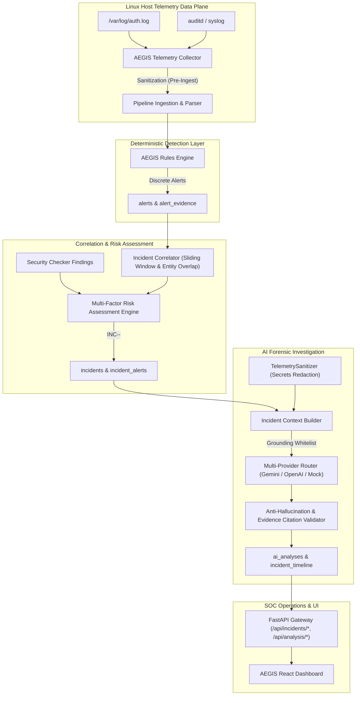

# AEGIS AI Security Analysis & Incident Investigation Architecture

## 1. System Overview
The AEGIS Security Platform integrates deterministic telemetry monitoring with an automated AI Incident Investigation engine. The architecture transitions discrete telemetry alerts into correlated, multi-stage attack scenarios, evaluates contextual threat severity through a multi-factor risk model, enforces zero-trust secret sanitization, and produces grounded AI forensic reports.

## 2. Core Architectural Pillars

### A. Strict Host Isolation
Telemetry and security events belonging to different physical or virtual hosts are partitioned strictly by `host_id`. The correlation engine guarantees that alerts from distinct hosts are never merged into a shared incident cluster.

### B. Ground Truth Only & Immutability
Alerts, evidence events, and rule triggers produced by the deterministic engine are strictly immutable. The AI investigation engine is prohibited from:
1. Mutating alert severities or detection timestamps.
2. Fabricating evidence citations outside the verified `allowed_evidence_ids` whitelist.
3. Overriding deterministic rule outputs.

### C. Multi-Provider Resiliency
The investigation engine employs a multi-provider fallback hierarchy:
- **Primary:** Google Gemini API (`gemini-3.5-flash-lite`) with automated key rotation across `AEGIS_LLM_API_KEY`, `AEGIS1`, `AEGIS2`, and `AEGIS3`.
- **Secondary:** OpenAI-compatible API endpoint (`gpt-4o-mini` or custom local inference gateway).
- **Offline / Air-Gapped:** Deterministic `MockAIProvider` synthesizing structured forensic reports without internet connectivity.
- **Graceful Null Fallback:** `NullAIProvider` reporting provider unavailability without degrading core detection data.

### D. Zero-Leakage Privacy Boundary
Before forensic context is dispatched to external AI models, `TelemetrySanitizer` scans and strips:
- OpenSSH, RSA, EC, and DSA private keys.
- Unix `/etc/shadow` password hashes ($1$, $5$, $6$, $y$, argon2).
- HTTP `Authorization: Bearer` and `Basic` tokens.
- Key-value credentials (`password=`, `api_key=`, `secret=`).
- Cloud service keys (AWS AKIA, Google AIza, GitHub ghp).
- Database connection strings with embedded passwords.
