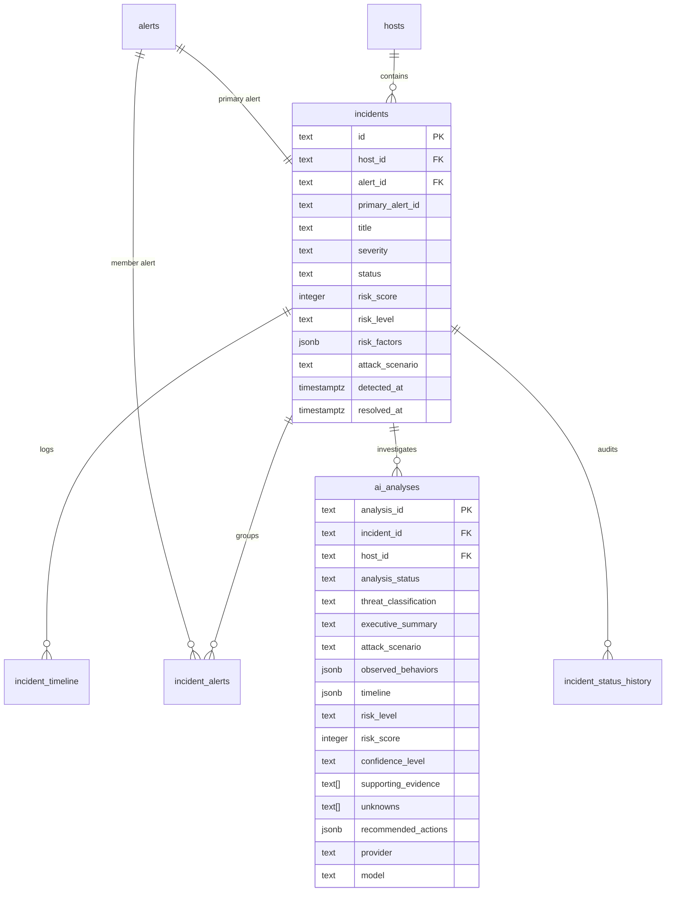

# AEGIS Incident Investigation Database Schema & Migration 004

## 1. Migration Specification
Database migration `004_incident_investigation.sql` introduces relational tables for incidents, alert junctions, timelines, AI analyses, and lifecycle history.

## 2. Integrity Constraints & Rules
1. **Host Foreign Key:** Every incident must reference an existing host in `public.hosts(id)`.
2. **Alert Severity Match Trigger:** Maintained compatibility with `trg_incidents_severity_match` from Migration 001 by retaining `alert_id` matching primary alert severity.
3. **Status Check Constraint:** `status IN ('open', 'new', 'investigating', 'mitigated', 'confirmed', 'resolved', 'closed', 'false_positive')`.
4. **Cascade Deletion:** Deleting an incident cleanly cascades to junction tables, timelines, and status history, but NEVER deletes original alerts or telemetry events.

## 3. Verification & Safe Rollback Scripts
- Verification: `supabase/verify_migration_004.sql`
- Rollback: `supabase/rollback_migration_004.sql`
  The rollback drops `incident_status_history`, `ai_analyses`, `incident_timeline`, `incident_alerts`, and `incidents` in reverse dependency order, leaving historical alerts and baseline tables completely untouched.
- Tested locally via PostgreSQL engine (PGlite in `tests/verify_incident_migration.cjs`).
