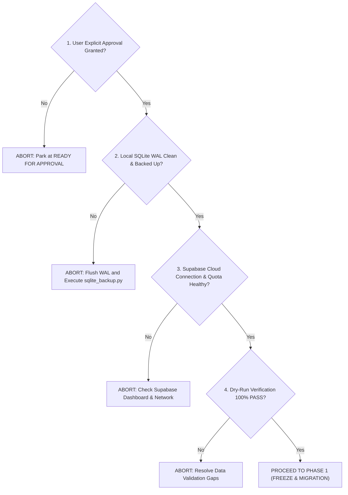

# AEGIS Cloud SSoT Cutover Runbook

## Document Information
- **System**: AEGIS Linux Security Monitoring & Incident Investigation
- **Target Architecture**: Unified Cloud Single Source of Truth (SSoT)
- **Target Database**: Supabase Cloud PostgreSQL (`hiwfbmwgnpnwaszltqwb.supabase.co`)
- **Document Version**: 1.0.0
- **Status**: READY FOR APPROVAL (Awaiting explicit operator authorization)

---

## 1. Executive Summary & Objective

This runbook defines the exact, deterministic operational procedure for transitioning AEGIS from its current **Resilient Hybrid Architecture** to **Unified Cloud Single Source of Truth (SSoT)**.

### Transition Scope
| Dimension | Hybrid Architecture (Pre-Cutover) | Unified Cloud SSoT (Post-Cutover) |
| :--- | :--- | :--- |
| **Telemetry & Alerts** | Supabase Cloud PostgreSQL | Supabase Cloud PostgreSQL |
| **Security Check Posture** | Cloud primary, SQLite fallback | Supabase Cloud PostgreSQL (Strict SSoT) |
| **Incident Investigation** | Local SQLite (`aegis_incidents.db`) | Supabase Cloud PostgreSQL (Strict SSoT) |
| **AI Analyses (4-Tier)** | Local SQLite (`aegis_incidents.db`) | Supabase Cloud PostgreSQL (Strict SSoT) |
| **Local SQLite Role** | Active operational read/write | Read-only local emergency replica / archive |
| **Silent Fallback Policy** | Permitted for unmigrated entities | **FORBIDDEN (Fail-loud on integrity violations)** |

---

## 2. Pre-Cutover Verification & Gate Criteria

Before executing this cutover, all gate criteria below MUST evaluate to `PASS`:



### Gate Checklist
- [ ] **Gate 1 - Operator Authorization**: Written user approval received in chat/ticket.
- [ ] **Gate 2 - Zero Write Drift**: Collector temporarily paused during cutover to guarantee immutable snapshot.
- [ ] **Gate 3 - WAL Checkpoint**: SQLite WAL file cleanly merged into main database file.
- [ ] **Gate 4 - Standalone Backup Created**: Verified backup stored at `/home/ubuntu/aegis/backups/`.
- [ ] **Gate 5 - Schema Dry-Run**: `node tests/verify_incident_migration.cjs` reports 5/5 passed.
- [ ] **Gate 6 - Data Dry-Run**: `python scripts/migrate_sqlite_to_supabase.py --dry-run` reports 0 errors across all 136 records.

---

## 3. Four-Phase Step-by-Step Cutover Execution

### Phase 1: Ingestion Freeze & Pre-Migration Safeguards ($T-15\text{ min}$ to $T-0$)

1. **Notify System Operators**:
   Announce scheduled maintenance window.
   > [!NOTE]
   > **Downtime Estimate vs Guarantee**: Total planned maintenance window is **estimated at 25 minutes** (active daemon restart interruption: $< 5\text{ minutes}$). This duration is an operational benchmark based on test simulations, **NOT a contractual guarantee**. If unexpected blocks occur during pre-migration gates or data transfer exceeding 15 minutes, the abort threshold is triggered immediately.

2. **Pause Ingestion & Background Agents on VM `fenn`**:
   ```bash
   sudo systemctl stop aegis-collector
   sudo systemctl stop aegis-backend
   ```
   > [!IMPORTANT]
   > **Zero Telemetry Loss Invariant (systemd-journald Buffering)**:
   > Pausing `aegis-collector` does **NOT** cause loss of SSH, authentication, or sudo events on the Linux host. The operating system kernel and `systemd-journald` continuously buffer all security events to persistent journal storage (`/var/log/journal/`). The collector tracks its read offset in a persistent cursor state file. Upon service restart in Phase 4, the collector resumes from the exact saved cursor offset, ingesting all accumulated logs with zero telemetry loss.

3. **Flush SQLite WAL and Create Immutable Pre-Cutover Backup**:
   ```bash
   python3 -c "
   import sqlite3
   conn = sqlite3.connect('/home/ubuntu/aegis/data/aegis_incidents.db')
   conn.execute('PRAGMA wal_checkpoint(TRUNCATE);')
   conn.close()
   "
   python3 /home/ubuntu/aegis/scripts/backup_sqlite.py
   ```
   *Verify backup archive created with non-zero size in `/home/ubuntu/aegis/backups/`.*

4. **Capture Supabase Cloud Baseline Snapshot**:
   Verify current row counts on Supabase Cloud:
   - `hosts`: 1
   - `telemetry_events`: 1,074
   - `alerts`: 13
   - `alert_evidence`: 23

---

### Phase 2: Schema Application on Supabase Cloud ($T+0$ to $T+5\text{ min}$)

Execute the three migration scripts in strict dependency order via the Supabase Management Console SQL Editor or authenticated migration tool:

1. **Step 2.1 — Migration 002 (Atomic RPC for Alert & Evidence)**:
   - File: `supabase/migrations/002_atomic_alert_evidence_rpc.sql`
   - Purpose: Creates function `public.fn_ingest_alert_with_evidence()`.
   - Verification Query:
     ```sql
     SELECT routine_name FROM information_schema.routines
     WHERE routine_name = 'fn_ingest_alert_with_evidence' AND routine_schema = 'public';
     ```

2. **Step 2.2 — Migration 003 (Security Posture Schema)**:
   - File: `supabase/migrations/003_security_posture_schema.sql`
   - Purpose: Creates `security_check_runs` and `security_findings` tables with RLS and foreign keys.
   - Verification Query:
     ```sql
     SELECT table_name FROM information_schema.tables
     WHERE table_schema = 'public' AND table_name IN ('security_check_runs', 'security_findings');
     ```

3. **Step 2.3 — Migration 004 (Incident Investigation & AI 4-Tier Reasoning)**:
   - File: `supabase/migrations/004_incident_investigation.sql`
   - Purpose: Enhances `incidents`, creates `incident_alerts`, `incident_risk_factors`, `incident_timeline`, `ai_analyses`, `incident_status_history`.
   - Verification Query:
     ```sql
     SELECT table_name FROM information_schema.tables
     WHERE table_schema = 'public' AND table_name IN (
       'incidents', 'incident_alerts', 'incident_risk_factors',
       'incident_timeline', 'ai_analyses', 'incident_status_history'
     );
     ```

---

### Phase 3: Data Migration Execution ($T+5$ to $T+15\text{ min}$)

Run the live data migration bridge script on VM `fenn`:

```bash
cd /home/ubuntu/aegis
python3 scripts/migrate_sqlite_to_supabase.py --target cloud
```

#### Expected Migration Progress Output:
- Stage 1: Security Check Runs (1 record inserted/updated)
- Stage 2: Security Findings (28 records inserted/updated)
- Stage 3: Incidents (14 records inserted/updated)
- Stage 4: Incident Alerts Linking (23 relations linked)
- Stage 5: Incident Risk Factors (42 risk factor rows preserved)
- Stage 6: Incident Timeline Items (21 events mapped)
- Stage 7: AI Forensic Analyses (7 records with full 4-tier reasoning)
- Stage 8: Incident Status History (11 transitions recorded)
- Stage 9: Host Posture Timestamps (host-fenn-ubuntu updated)

#### Validation Check:
Inspect the generated `migration_report.json`:
- `summary.total_records`: 136
- `summary.errors`: 0
- `summary.status`: `SUCCESS`

---

### Phase 4: Application Cutover & Service Re-activation ($T+15$ to $T+25\text{ min}$)

1. **Activate Cloud SSoT Mode in Configuration**:
   Update `/home/ubuntu/aegis/.env`:
   ```bash
   AEGIS_DATABASE_MODE=cloud_ssot
   ```

2. **Restart Services**:
   ```bash
   sudo systemctl daemon-reload
   sudo systemctl restart aegis-backend
   sudo systemctl start aegis-collector
   ```

3. **Post-Cutover Smoke Tests**:
   - Check system status and database mode:
     ```bash
     curl -s http://127.0.0.1:8000/api/system/status | jq .
     ```
     *Verify: `database.connected == true`, `config.database_mode == "cloud_ssot"`.*

   - Verify Incidents endpoint (Direct Cloud Read):
     ```bash
     curl -s http://127.0.0.1:8000/api/incidents | jq .total
     ```
     *Verify: returns 14 incidents.*

   - Verify Security Posture Summary (Direct Cloud Read):
     ```bash
     curl -s http://127.0.0.1:8000/api/security-checks/summary | jq .
     ```
     *Verify: `total_checks == 28`, `failed >= 1`.*

   - Verify 4-Tier AI Investigation Retrieval:
     ```bash
     curl -s http://127.0.0.1:8000/api/incidents/INC-host-fenn-ubuntu-d3949a80/investigation | jq .analysis_status
     ```
     *Verify: returns `"completed"`.*

---

## 4. Post-Cutover Monitoring & Stability Verification

Monitor the system continuously for 60 minutes following cutover:
- **Application Logs**:
  ```bash
  sudo journalctl -u aegis-backend -f -n 50
  ```
  *Ensure NO warnings containing "Reading from persistent SQLite store" or "PGRST205".*
- **Ingestion Latency**: Telemetry batch ingestion response time must remain $< 250\text{ ms}$.
- **Dashboard UI**: Refresh Aegis UI dashboard, verify all 14 incidents, alert feeds, and security check tabs display live data.

---

## 5. Rollback Triggers

Immediately halt and execute `docs/CLOUD_MIGRATION_ROLLBACK.md` if ANY of the following occur:
1. Migration 002, 003, or 004 execution fails with unrecoverable SQL syntax or permission errors.
2. Data migration fails with foreign key violations or data corruption.
3. `/api/incidents` returns HTTP 500 or fails to query Supabase PostgREST.
4. Database roundtrip latency exceeds $1,500\text{ ms}$ sustained over 5 minutes.

