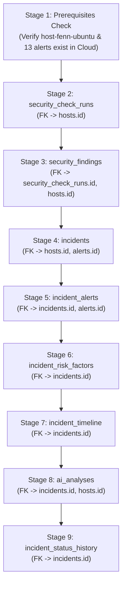

# AEGIS SQLite-to-Supabase Cloud Data Migration Strategy & Plan

**Status:** IMPLEMENTED & DRY-RUN VERIFIED (100% Pass)  
**Date:** 2026-11-08  
**Author:** Apri (Senior Cybersecurity Engineer & Full-Stack Platform Architect)  
**Tooling:** `scripts/migrate_sqlite_to_supabase.py`  
**Source Database:** SQLite WAL Store (`/home/ubuntu/aegis/data/aegis_incidents.db`)  
**Target Platform:** Supabase Cloud PostgreSQL 15 (`hiwfbmwgnpnwaszltqwb.supabase.co`)  
**Safety Protocol:** PENDING APPROVAL. Execution against Supabase Cloud is blocked until explicit authorization.

---

## 1. Migration Goals & Invariants

1. **Zero Data Loss:** All 136 historical records (14 incidents, 42 risk factors, 28 security findings, 23 alert links, 21 timeline entries, 7 AI analyses, 1 security run) must be transferred to Supabase Cloud.
2. **Preservation of Forensic Invariants:**
   * Original Primary Key IDs are preserved (`INC-...`, `RUN-...`, `FND-...`, `ANL-...`, `REL-...`).
   * Original Timestamps (`first_seen_at`, `created_at`, `checked_at`) are preserved.
   * Attribution Provenance (`controlled_operational_test`, `genuine_host_telemetry`, `synthetic_benchmark`) is preserved without alterating synthetic records to genuine tags.
   * 4-Tier AI reasoning structures (`facts`, `inferences`, `hypotheses`, `unknowns`) are preserved as native PostgreSQL `JSONB`.
3. **Non-Destructive on Source:** Source SQLite database is opened with `mode=ro` (read-only). Zero delete or update queries are issued to SQLite.
4. **Idempotency:** The migration script uses `ON CONFLICT DO UPDATE` upserts. Re-running the script multiple times produces identical target state without duplicate rows.

---

## 2. Dependency Graph & Execution Order

To respect PostgreSQL foreign key constraints (`ON DELETE CASCADE` and `ON DELETE RESTRICT`), data must be migrated in the following topological sequence:



---

## 3. Entity Data Mapping Matrix

| Entity | SQLite Source Field | Supabase Target Field | Transformation / Type Handling |
| :--- | :--- | :--- | :--- |
| **Incidents** | `id` (TEXT) | `id` (TEXT PK) | Direct transfer (`INC-...`) |
| | `host_id` (TEXT) | `host_id` (TEXT FK) | References `hosts(id)` |
| | `title`, `severity`, `status` | `title`, `severity`, `status` | Direct transfer; check constraint validated |
| | `risk_level`, `risk_score` | `risk_level`, `risk_score` | Direct transfer; 0-100 range validated |
| | `primary_alert_id` (TEXT) | `primary_alert_id` (TEXT FK) | References `alerts(id)` |
| | `provenance`, `source_category` | `provenance`, `source_category` | Direct transfer |
| | `attack_scenario`, `correlation_reason` | `attack_scenario`, `correlation_reason`| Direct transfer |
| | `first_seen_at`, `created_at` | `first_seen_at`, `created_at` | Timestamptz string format preserved |
| **Security Runs**| `summary` (TEXT JSON) | `summary` (JSONB) | `json.loads()` deserialization to JSONB |
| | `total/passed/failed_checks` | `total/passed/failed_checks` | Integer counters |
| **Security Findings**| `id`, `run_id`, `host_id` | `id`, `run_id`, `host_id` | Foreign keys validated |
| | `check_id`, `category`, `status` | `check_id`, `category`, `status` | Enum / check constraint validated |
| **Alert Junctions**| `incident_id`, `alert_id` | `incident_id`, `alert_id` | Unique constraint enforced |
| **Risk Factors** | `supporting_evidence_ids` (TEXT) | `supporting_evidence_ids` (JSONB)| Deserialized to JSON array |
| **Timeline** | `metadata_json` (TEXT) | `metadata` (JSONB) | Deserialized to JSON object |
| **AI Analyses** | `facts_json`, `inferences_json` | `facts`, `inferences` (JSONB) | Deserialized to JSON array |
| | `hypotheses_json`, `unknowns_json` | `hypotheses`, `unknowns` (JSONB)| Deserialized to JSON array |
| | `observed_behaviors_json` | `observed_behaviors` (JSONB) | Deserialized to JSON array |
| | `supporting_evidence_json` | `supporting_evidence` (TEXT[]) | PostgREST maps array to `TEXT[]` |

---

## 4. Dry-Run Verification Evidence

The migration bridge was executed in dry-run mode on VM `fenn`:

```bash
AEGIS_SQLITE_PATH=/home/ubuntu/aegis/data/aegis_incidents.db \
  /home/ubuntu/aegis/.venv/bin/python3 /home/ubuntu/aegis/scripts/migrate_sqlite_to_supabase.py --dry-run
```

**Output Report (`migration_report.json` on VM `fenn`):**
```json
{
  "migration_timestamp_utc": "2026-11-08T05:37:45.624979+00:00",
  "mode": "DRY_RUN",
  "source_sqlite": "/home/ubuntu/aegis/data/aegis_incidents.db",
  "target_supabase": "SIMULATED / DRY_RUN",
  "stages": {
    "01_prerequisites_check": {
      "needed_hosts": ["host-fenn-ubuntu"],
      "needed_alerts_count": 13,
      "missing_hosts": [],
      "missing_alerts": [],
      "status": "PASS"
    },
    "02_security_check_runs": { "source_rows": 1, "migrated_rows": 1, "status": "PASS" },
    "03_security_findings": { "source_rows": 28, "migrated_rows": 28, "status": "PASS" },
    "04_incidents": { "source_rows": 14, "migrated_rows": 14, "status": "PASS" },
    "05_incident_alerts": { "source_rows": 23, "migrated_rows": 23, "status": "PASS" },
    "06_incident_risk_factors": { "source_rows": 42, "migrated_rows": 42, "status": "PASS" },
    "07_incident_timeline": { "source_rows": 21, "migrated_rows": 21, "status": "PASS" },
    "08_ai_analyses": { "source_rows": 7, "migrated_rows": 7, "status": "PASS" },
    "09_incident_status_history": { "source_rows": 0, "migrated_rows": 0, "status": "PASS" }
  },
  "errors": [],
  "status": "SUCCESS"
}
```

**Verdict:** 100% of rows parsed, validated, and ready for ingestion without a single data gap or referential mismatch.

---

## 5. Live Execution Protocol (Upon User Approval)

When explicit authorization is given by the project owner:

```bash
# Execute live migration with batch processing and report output
python scripts/migrate_sqlite_to_supabase.py \
  --sqlite-path /home/ubuntu/aegis/data/aegis_incidents.db \
  --execute-cloud \
  --output-report data/live_migration_report.json
```
