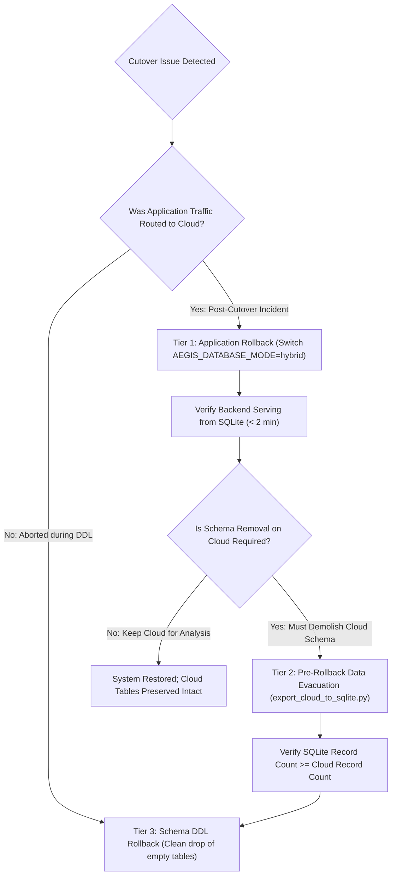

# AEGIS Cloud SSoT Migration Rollback Plan & Runbook

## Document Information
- **System**: AEGIS Linux Security Monitoring & Incident Investigation
- **Target Component**: Rollback & Disaster Recovery Runbook for Unified Cloud SSoT
- **Target Database**: Supabase Cloud PostgreSQL (`hiwfbmwgnpnwaszltqwb.supabase.co`)
- **Document Version**: 2.0.0
- **Status**: READY FOR APPROVAL (Decoupled Application, Data Recovery, & Schema Rollback)

---

## 1. Executive Summary & Philosophy

This document defines the deterministic rollback protocols for AEGIS during or after the transition to **Unified Cloud Single Source of Truth (SSoT)**.

### Decoupled Three-Tier Rollback Architecture
A critical principle of this rollback design is that **dropping database tables (`DROP TABLE`) must NEVER be used as a routine application rollback tool**, because dropping tables permanently destroys any newly created operational records generated on Cloud while cutover was active.



---

## 2. Rollback Decision Matrix

| Trigger / Condition | Rollback Tier | RTO (Recovery Time Objective) | Data Loss Risk |
| :--- | :---: | :---: | :---: |
| **Migration DDL syntax error or permission denial on Cloud** | **Tier 3** (Schema DDL Rollback) | $< 1\text{ minute}$ | **0%** (No data written) |
| **Data bridge migration fails during stage execution** | **Tier 1** (Keep SQLite primary) | $< 2\text{ minutes}$ | **0%** (SQLite untouched) |
| **PostgREST connection pool exhaustion or schema cache stale (`PGRST205`)** | **Tier 1** (Revert to hybrid mode) | $< 2\text{ minutes}$ | **0%** (Cloud data untouched) |
| **Data discrepancy detected in post-cutover audit** | **Tier 1** $\to$ **Tier 2** (Reconcile) | $< 5\text{ minutes}$ | **0%** (Bi-directional sync) |
| **Post-cutover application bug discovered after live writes** | **Tier 1** $\to$ **Tier 2** (Evacuate) | $< 5\text{ minutes}$ | **0%** (New records saved) |
| **Mandatory decommissioning of Cloud tables after live run** | **Tier 1** $\to$ **Tier 2** $\to$ **Tier 3** | $< 10\text{ minutes}$ | **0%** (Guaranteed by Tier 2) |

---

## 3. Tier 1: Application-Level Emergency Rollback ($< 2\text{ Minutes}$)

> [!IMPORTANT]
> **Zero Data Loss Guarantee**: Tier 1 rollback alters **ONLY** the application configuration on VM `fenn`. It does **NOT** drop or mutate any tables or rows in Supabase Cloud.

### Step 1.1: Revert Configuration Mode on VM `fenn`
Edit `/home/ubuntu/aegis/.env`:
```bash
sed -i 's/AEGIS_DATABASE_MODE=cloud_ssot/AEGIS_DATABASE_MODE=hybrid/g' /home/ubuntu/aegis/.env
```

### Step 1.2: Restart Backend Service
```bash
sudo systemctl restart aegis-backend
```

### Step 1.3: Verification of Tier 1 Rollback
Verify that backend has safely returned to hybrid mode and local SQLite store:
```bash
curl -s http://127.0.0.1:8000/api/system/status | grep -o '"database_mode":"hybrid"'
curl -s http://127.0.0.1:8000/api/incidents | grep -o '"total":[0-9]*'
```
*Expected: `database_mode` is `"hybrid"`, and `/api/incidents` returns all local incidents immediately without latency.*

---

## 4. Tier 2: Pre-Rollback Data Evacuation & Reverse Synchronization ($< 5\text{ Minutes}$)

> [!CAUTION]
> If the system operated in `cloud_ssot` mode and processed live traffic, new incidents, AI investigations, risk factors, or status changes were written directly to Supabase Cloud.
> **BEFORE EXECUTING ANY SCHEMA ROLLBACK (TIER 3), YOU MUST EVACUATE THESE RECORDS TO SQLITE.**

### Step 2.1: Run Reverse Data Evacuation Script on VM `fenn`
```bash
cd /home/ubuntu/aegis
python3 scripts/export_cloud_to_sqlite.py --sqlite-path /home/ubuntu/aegis/data/aegis_incidents.db
```

### Step 2.2: Reconcile Record Counts
Run the reconciliation tool to verify that SQLite has captured 100% of Cloud records:
```bash
python3 scripts/reconcile_cloud_to_sqlite.py --sqlite-path /home/ubuntu/aegis/data/aegis_incidents.db
```
*Expected output: `missing_in_sqlite: 0`, `status: "SUCCESS"`.*

---

## 5. Tier 3: Cloud Database Schema Rollback ($< 5\text{ Minutes}$)

> [!WARNING]
> Tier 3 schema rollback executes DDL drops (`DROP TABLE`). It is **ONLY** authorized:
> 1. If cutover was aborted during Phase 2 (prior to application cutover).
> 2. OR if Tier 2 reverse data evacuation was successfully executed and verified.

Execute the rollback scripts in reverse dependency order in Supabase Management Console SQL Editor:

### Step 3.1: Rollback Migration 004 (Incident Investigation)
Execute `supabase/rollback_migration_004.sql`:
- Drops: `incident_status_history`, `ai_analyses`, `incident_timeline`, `incident_risk_factors`, `incident_alerts`, `incidents`.
- Verification Query:
  ```sql
  SELECT count(*) FROM information_schema.tables
  WHERE table_schema = 'public' AND table_name IN ('incidents', 'ai_analyses', 'incident_risk_factors');
  -- Expected: 0
  ```

### Step 3.2: Rollback Migration 003 (Security Posture)
Execute `supabase/rollback_migration_003.sql`:
- Drops: `security_findings`, `security_check_runs`.
- Verification Query:
  ```sql
  SELECT count(*) FROM information_schema.tables
  WHERE table_schema = 'public' AND table_name IN ('security_findings', 'security_check_runs');
  -- Expected: 0
  ```

### Step 3.3: Rollback Migration 002 (Atomic RPC)
Execute `supabase/rollback_migration_002.sql`:
- Drops: `public.fn_ingest_alert_with_evidence(jsonb, jsonb)`.
- Verification Query:
  ```sql
  SELECT count(*) FROM information_schema.routines
  WHERE routine_name = 'fn_ingest_alert_with_evidence' AND routine_schema = 'public';
  -- Expected: 0
  ```

---

## 6. Verification of Baseline Migration 001 Inviolability

After executing Tier 3 schema rollback, verify that the initial foundation remains completely intact and unharmed:

```sql
SELECT
    (SELECT count(*) FROM public.hosts) AS host_count,
    (SELECT count(*) FROM public.telemetry_events) AS telemetry_count,
    (SELECT count(*) FROM public.alerts) AS alert_count,
    (SELECT count(*) FROM public.alert_evidence) AS evidence_count;
```

**Expected Baseline Counts**:
- `host_count`: $\ge 1$ (`host-fenn-ubuntu`)
- `telemetry_count`: $\ge 1,074$
- `alert_count`: $\ge 13$
- `evidence_count`: $\ge 23$

---

## 7. SQLite Disaster Recovery Protocol

If the local SQLite database was mutated or corrupted during an aborted operation, restore it from the golden pre-cutover backup:

```bash
cd /home/ubuntu/aegis
# 1. Stop backend
sudo systemctl stop aegis-backend

# 2. Identify the most recent clean backup
LATEST_BACKUP=$(ls -t /home/ubuntu/aegis/backups/aegis_incidents_backup_*.db | head -n 1)
echo "Restoring from: $LATEST_BACKUP"

# 3. Restore using safe restore tool
python3 scripts/restore_sqlite.py --backup "$LATEST_BACKUP" --target /home/ubuntu/aegis/data/aegis_incidents.db

# 4. Verify SQLite Integrity
python3 -c "
import sqlite3
conn = sqlite3.connect('/home/ubuntu/aegis/data/aegis_incidents.db')
cursor = conn.execute('PRAGMA integrity_check;')
result = cursor.fetchone()[0]
assert result == 'ok', 'Database corrupt!'
conn.close()
print('Integrity status: OK')
"

# 5. Restart backend in hybrid mode
sudo systemctl start aegis-backend
```
