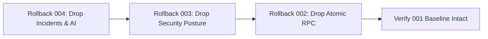

# AEGIS Cloud SSoT Migration Rollback Plan & Runbook

## Document Information
- **System**: AEGIS Linux Security Monitoring & Incident Investigation
- **Target Component**: Rollback Runbook for Unified Cloud SSoT Migration
- **Target Database**: Supabase Cloud PostgreSQL (`hiwfbmwgnpnwaszltqwb.supabase.co`)
- **Document Version**: 1.0.0
- **Status**: READY FOR APPROVAL (Emergency Contingency Runbook)

---

## 1. Executive Summary & Philosophy

This document defines the emergency rollback protocols for AEGIS during or after the transition to **Unified Cloud Single Source of Truth (SSoT)**.

### Core Rollback Guarantees
1. **Zero Data Loss**: The pre-cutover SQLite snapshot (`aegis_incidents.db`) is treated as an immutable golden copy until cutover verification is 100% accepted.
2. **Tiered Rollback**:
   - **Tier 1 (Application Rollback)**: Fast software-level reversion ($< 2\text{ minutes}$) that switches `database_mode` back to `hybrid` without dropping cloud tables.
   - **Tier 2 (Full Schema Rollback)**: Clean, non-destructive SQL rollback scripts that drop migrations 004, 003, and 002 while strictly preserving migration 001 baseline data (`telemetry_events`, `alerts`, `hosts`).
3. **Deterministic Verification**: Every rollback step is accompanied by explicit verification queries.

---

## 2. Rollback Decision Matrix

| Condition | Rollback Action | RTO (Recovery Time Objective) |
| :--- | :--- | :--- |
| **Migration DDL syntax error or permission denial on Cloud** | Stop immediately; fix SQL or abort; no app impact | $< 1\text{ minute}$ |
| **Data bridge migration fails during stage execution** | Tier 1 (Keep SQLite primary); inspect log | $< 3\text{ minutes}$ |
| **PostgREST connection pool exhaustion or schema cache stale (`PGRST205`)** | Reload PostgREST schema cache; if unresolved, Tier 1 | $< 5\text{ minutes}$ |
| **Data discrepancy detected in post-cutover audit ($> 0\text{ missing records}$)** | Tier 1 application rollback; re-run dry-run reconciliation | $< 5\text{ minutes}$ |
| **Unrecoverable Cloud PostgreSQL crash or fatal corruption** | Tier 1 application rollback + Tier 2 full schema rollback | $< 10\text{ minutes}$ |

---

## 3. Tier 1: Application-Level Emergency Rollback ($< 2\text{ Minutes}$)

If the backend encounters errors after cutover, the operator can restore full system operational status without touching the cloud database schema.

### Step 1.1: Revert Configuration Mode
On VM `fenn`, edit `/home/ubuntu/aegis/.env` (or run sed):
```bash
sed -i 's/AEGIS_DATABASE_MODE=cloud_ssot/AEGIS_DATABASE_MODE=hybrid/g' /home/ubuntu/aegis/.env
```

### Step 1.2: Restart Backend Service
```bash
sudo systemctl restart aegis-backend
```

### Step 1.3: Verification of Tier 1 Rollback
Verify that backend has safely returned to hybrid mode and local SQLite store:
```bash
curl -s http://127.0.0.1:8000/api/system/status | jq '{db_mode: .config.database_mode, sqlite: .config.sqlite_db_path}'
curl -s http://127.0.0.1:8000/api/incidents | jq .total
```
*Expected: `db_mode` is `"hybrid"`, and `/api/incidents` returns all 14 local incidents immediately.*

---

## 4. Tier 2: Cloud Database Schema Rollback ($< 5\text{ Minutes}$)

If migrations 002, 003, or 004 must be revoked from Supabase Cloud, execute the provided rollback scripts in reverse chronological order:



### Step 2.1: Rollback Migration 004 (Incident Investigation)
Execute `supabase/rollback_migration_004.sql` in Supabase SQL Editor:
- Drops tables in dependency order:
  1. `incident_status_history`
  2. `ai_analyses`
  3. `incident_timeline`
  4. `incident_risk_factors`
  5. `incident_alerts`
  6. `incidents`
- Reverts column modifications on baseline schema.
- **Verification Query**:
  ```sql
  SELECT count(*) FROM information_schema.tables
  WHERE table_schema = 'public' AND table_name IN ('incidents', 'ai_analyses', 'incident_risk_factors');
  -- Expected: 0
  ```

### Step 2.2: Rollback Migration 003 (Security Posture)
Execute `supabase/rollback_migration_003.sql` in Supabase SQL Editor:
- Drops tables:
  1. `security_findings`
  2. `security_check_runs`
- Removes `last_sc_run_at` column from `hosts` table if added.
- **Verification Query**:
  ```sql
  SELECT count(*) FROM information_schema.tables
  WHERE table_schema = 'public' AND table_name IN ('security_findings', 'security_check_runs');
  -- Expected: 0
  ```

### Step 2.3: Rollback Migration 002 (Atomic RPC)
Execute `supabase/rollback_migration_002.sql` in Supabase SQL Editor:
- Drops stored procedure: `public.fn_ingest_alert_with_evidence(jsonb, jsonb)`.
- **Verification Query**:
  ```sql
  SELECT count(*) FROM information_schema.routines
  WHERE routine_name = 'fn_ingest_alert_with_evidence' AND routine_schema = 'public';
  -- Expected: 0
  ```

---

## 5. Verification of Baseline Migration 001 Inviolability

After executing Tier 2 schema rollback, verify that the initial foundation remains completely intact and unharmed:

```sql
SELECT
    (SELECT count(*) FROM public.hosts) AS host_count,
    (SELECT count(*) FROM public.telemetry_events) AS telemetry_count,
    (SELECT count(*) FROM public.alerts) AS alert_count,
    (SELECT count(*) FROM public.alert_evidence) AS evidence_count;
```

**Expected Baseline Counts**:
- `host_count`: $\ge 1$ (`host-fenn-ubuntu`)
- `telemetry_count`: $\ge 1,074$
- `alert_count`: $\ge 13$
- `evidence_count`: $\ge 23$

---

## 6. SQLite Disaster Recovery Protocol

If the local SQLite database was inadvertently corrupted during cutover, restore it from the golden pre-cutover backup:

```bash
cd /home/ubuntu/aegis
# 1. Stop backend
sudo systemctl stop aegis-backend

# 2. Identify the most recent clean backup
LATEST_BACKUP=$(ls -t /home/ubuntu/aegis/backups/aegis_incidents_backup_*.db | head -n 1)
echo "Restoring from: $LATEST_BACKUP"

# 3. Restore using safe restore tool
python3 scripts/restore_sqlite.py --backup "$LATEST_BACKUP" --target /home/ubuntu/aegis/data/aegis_incidents.db

# 4. Verify SQLite Integrity
python3 -c "
import sqlite3
conn = sqlite3.connect('/home/ubuntu/aegis/data/aegis_incidents.db')
cursor = conn.execute('PRAGMA integrity_check;')
result = cursor.fetchone()[0]
print('Integrity status:', result)
assert result == 'ok', 'Database corrupt!'
conn.close()
"

# 5. Restart backend in hybrid mode
sudo systemctl start aegis-backend
```

---

## 7. Post-Rollback Postmortem & Reporting Runbook

1. Capture full journalctl logs from `aegis-backend` during the failure window:
   ```bash
   sudo journalctl -u aegis-backend --since "1 hour ago" > /tmp/cutover_failure_journal.log
   ```
2. Archive `migration_report.json` with timestamp:
   ```bash
   cp /home/ubuntu/aegis/migration_report.json /home/ubuntu/aegis/logs/failed_migration_$(date +%Y%m%d_%H%M%S).json
   ```
3. Formulate root-cause analysis report identifying whether failure was due to network timeout, PostgREST schema cache delay, or constraint mismatch.
