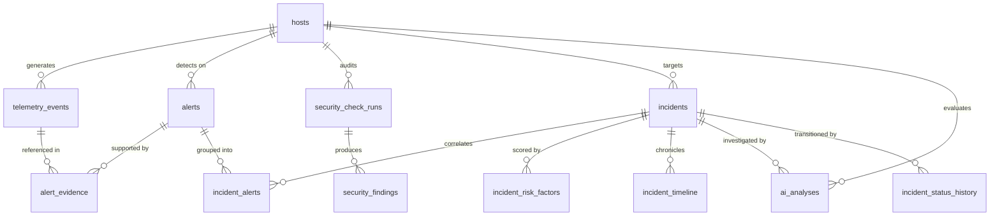

# AEGIS Unified Cloud SSoT Schema Design Specification

**Status:** DESIGNED & VERIFIED (Local Test Harness 100% Passed)  
**Date:** 2026-11-08  
**Author:** Apri (Senior Cybersecurity Engineer & Full-Stack Platform Architect)  
**Target Platform:** Supabase Cloud PostgreSQL 15 (`hiwfbmwgnpnwaszltqwb.supabase.co`)  
**Safety Protocol:** PENDING APPROVAL. Zero DDL executed on Cloud without explicit user authorization.

---

## 1. Unified SSoT Architectural Vision

The Unified Cloud Single Source of Truth (SSoT) consolidates all operational security data of AEGIS into Supabase Cloud PostgreSQL. This establishes a single relational database engine capable of performing join-level correlations from raw operating system telemetry up to AI forensic analysis and configuration compliance audits.



---

## 2. Definitive Entity & Table Inventory (11 Core Entities)

| # | Entity Name | Table Name | Migration Origin | Relational Role |
| :--- | :--- | :--- | :--- | :--- |
| 1 | **Hosts** | `public.hosts` | `001_initial_schema.sql` | Monitored Linux server instances |
| 2 | **Telemetry Events** | `public.telemetry_events` | `001_initial_schema.sql` | Raw normalized auditd/auth/syslog log stream |
| 3 | **Alerts** | `public.alerts` | `001_initial_schema.sql` | Deterministic rules engine detection hits |
| 4 | **Evidence** | `public.alert_evidence` | `001_initial_schema.sql` | Foreign key citations linking alerts to raw events |
| 5 | **Incidents** | `public.incidents` | `001` enhanced in `004` | Correlated security cases with risk scoring & attribution |
| 6 | **Incident Alerts** | `public.incident_alerts` | `004_incident_investigation.sql` | N-to-N junction linking multiple alerts to an incident |
| 7 | **Incident Risk Factors**| `public.incident_risk_factors` | `004_incident_investigation.sql` | Transparent point breakdowns and evidence citations |
| 8 | **Incident Timeline** | `public.incident_timeline` | `004_incident_investigation.sql` | Chronological unified incident forensic timeline |
| 9 | **AI Analyses** | `public.ai_analyses` | `004_incident_investigation.sql` | 4-Tier grounded LLM forensic reports & hypotheses |
| 10 | **Status History** | `public.incident_status_history`| `004_incident_investigation.sql` | Tamper-evident incident state transition audit trail |
| 11 | **Security Checker** | `public.security_check_runs` & `public.security_findings` | `003_security_checker.sql` | CIS Linux configuration compliance audits & posture |

---

## 3. Schema DDL Specifications & Constraints

### 3.1 Migration Sequence & Responsibilities
1. **`001_initial_schema.sql` (Active on Cloud):**
   * Baseline infrastructure: `hosts`, `telemetry_events`, `alerts`, `alert_evidence`, `system_status`.
2. **`002_atomic_alert_evidence_rpc.sql` (Pending):**
   * Stored procedure `fn_ingest_alert_with_evidence(p_alerts JSONB, p_evidence JSONB)` for atomic transaction-safe batch writes.
3. **`003_security_checker.sql` (Pending):**
   * Tables: `security_check_runs`, `security_findings`.
   * Trigger: `trg_sc_runs_sync_host` on `security_check_runs` updates `hosts.last_sc_run_at`.
4. **`004_incident_investigation.sql` (Enhanced Final Version):**
   * Non-destructive evolution of `incidents` (+14 columns).
   * Tables: `incident_alerts`, `incident_risk_factors`, `incident_timeline`, `ai_analyses`, `incident_status_history`.

---

### 3.2 Table DDL Definitions (Detailed)

#### 1. Enhanced `public.incidents`
```sql
CREATE TABLE IF NOT EXISTS public.incidents (
    id TEXT PRIMARY KEY, -- e.g. 'INC-host-fenn-ubuntu-8c09ddcc6166'
    alert_id TEXT REFERENCES public.alerts(id) ON DELETE RESTRICT,
    host_id TEXT NOT NULL REFERENCES public.hosts(id) ON DELETE RESTRICT,
    title TEXT NOT NULL,
    severity VARCHAR(20) NOT NULL CHECK (severity IN ('critical', 'high', 'medium', 'low', 'info')),
    status VARCHAR(32) NOT NULL DEFAULT 'new'
        CHECK (status IN ('new', 'investigating', 'confirmed', 'false_positive', 'contained', 'resolved', 'open', 'closed')),
    assigned_to VARCHAR(100),
    created_at TIMESTAMPTZ NOT NULL DEFAULT now(),
    updated_at TIMESTAMPTZ NOT NULL DEFAULT now()
);

-- Evolved columns
ALTER TABLE public.incidents ALTER COLUMN alert_id DROP NOT NULL;
ALTER TABLE public.incidents ADD COLUMN IF NOT EXISTS primary_alert_id TEXT REFERENCES public.alerts(id) ON DELETE SET NULL;
ALTER TABLE public.incidents ADD COLUMN IF NOT EXISTS risk_level VARCHAR(20) NOT NULL DEFAULT 'medium'
    CHECK (risk_level IN ('critical', 'high', 'medium', 'low'));
ALTER TABLE public.incidents ADD COLUMN IF NOT EXISTS risk_score INTEGER NOT NULL DEFAULT 50
    CHECK (risk_score >= 0 AND risk_score <= 100);
ALTER TABLE public.incidents ADD COLUMN IF NOT EXISTS alert_count INTEGER NOT NULL DEFAULT 1;
ALTER TABLE public.incidents ADD COLUMN IF NOT EXISTS source_ip VARCHAR(45);
ALTER TABLE public.incidents ADD COLUMN IF NOT EXISTS target_user VARCHAR(100);
ALTER TABLE public.incidents ADD COLUMN IF NOT EXISTS attack_scenario TEXT;
ALTER TABLE public.incidents ADD COLUMN IF NOT EXISTS correlation_reason TEXT;
ALTER TABLE public.incidents ADD COLUMN IF NOT EXISTS provenance VARCHAR(50) DEFAULT 'synthetic_benchmark';
ALTER TABLE public.incidents ADD COLUMN IF NOT EXISTS source_category VARCHAR(50) DEFAULT 'unknown';
ALTER TABLE public.incidents ADD COLUMN IF NOT EXISTS source_label VARCHAR(100);
ALTER TABLE public.incidents ADD COLUMN IF NOT EXISTS threat_actor_context TEXT;
ALTER TABLE public.incidents ADD COLUMN IF NOT EXISTS first_seen_at TIMESTAMPTZ NOT NULL DEFAULT now();
ALTER TABLE public.incidents ADD COLUMN IF NOT EXISTS last_seen_at TIMESTAMPTZ NOT NULL DEFAULT now();

CREATE INDEX IF NOT EXISTS idx_incidents_host_status ON public.incidents(host_id, status);
CREATE INDEX IF NOT EXISTS idx_incidents_risk_level ON public.incidents(risk_level);
CREATE INDEX IF NOT EXISTS idx_incidents_created ON public.incidents(created_at DESC);
```

#### 2. `public.incident_alerts` (Junction Table)
```sql
CREATE TABLE IF NOT EXISTS public.incident_alerts (
    id TEXT PRIMARY KEY DEFAULT ('REL-' || gen_random_uuid()::text),
    incident_id TEXT NOT NULL REFERENCES public.incidents(id) ON DELETE CASCADE,
    alert_id TEXT NOT NULL REFERENCES public.alerts(id) ON DELETE RESTRICT,
    added_at TIMESTAMPTZ NOT NULL DEFAULT now(),
    created_at TIMESTAMPTZ NOT NULL DEFAULT now(),
    CONSTRAINT uq_incident_alert UNIQUE (incident_id, alert_id)
);

CREATE INDEX IF NOT EXISTS idx_incident_alerts_inc ON public.incident_alerts(incident_id);
CREATE INDEX IF NOT EXISTS idx_incident_alerts_alert ON public.incident_alerts(alert_id);
```

#### 3. `public.incident_risk_factors` (Factor Breakdown)
```sql
CREATE TABLE IF NOT EXISTS public.incident_risk_factors (
    id TEXT PRIMARY KEY,
    incident_id TEXT NOT NULL REFERENCES public.incidents(id) ON DELETE CASCADE,
    factor_id VARCHAR(100) NOT NULL,
    factor_name TEXT NOT NULL,
    points INTEGER NOT NULL,
    category VARCHAR(50) NOT NULL,
    description TEXT,
    supporting_evidence_ids JSONB NOT NULL DEFAULT '[]'::jsonb,
    created_at TIMESTAMPTZ NOT NULL DEFAULT now(),
    CONSTRAINT uq_incident_factor UNIQUE (incident_id, factor_id)
);

CREATE INDEX IF NOT EXISTS idx_risk_factors_inc ON public.incident_risk_factors(incident_id);
```

#### 4. `public.incident_timeline` (Forensic Timeline)
```sql
CREATE TABLE IF NOT EXISTS public.incident_timeline (
    id TEXT PRIMARY KEY DEFAULT gen_random_uuid()::text,
    incident_id TEXT NOT NULL REFERENCES public.incidents(id) ON DELETE CASCADE,
    timestamp TIMESTAMPTZ NOT NULL,
    kind VARCHAR(32) NOT NULL CHECK (kind IN ('event', 'alert', 'finding', 'analysis', 'status_change', 'test_scenario')),
    title TEXT NOT NULL,
    description TEXT NOT NULL,
    severity VARCHAR(32),
    metadata JSONB NOT NULL DEFAULT '{}'::jsonb,
    created_at TIMESTAMPTZ NOT NULL DEFAULT now()
);

CREATE INDEX IF NOT EXISTS idx_incident_timeline_inc_ts ON public.incident_timeline(incident_id, timestamp ASC);
```

#### 5. `public.ai_analyses` (4-Tier AI Forensic Reasoning)
```sql
CREATE TABLE IF NOT EXISTS public.ai_analyses (
    id VARCHAR(128) PRIMARY KEY, -- e.g. 'ANL-INC-...-17940'
    incident_id TEXT REFERENCES public.incidents(id) ON DELETE CASCADE,
    alert_id TEXT REFERENCES public.alerts(id) ON DELETE SET NULL,
    host_id TEXT NOT NULL REFERENCES public.hosts(id) ON DELETE CASCADE,
    analysis_status VARCHAR(32) NOT NULL CHECK (analysis_status IN ('completed', 'partial', 'insufficient_data', 'failed', 'unavailable')),
    threat_classification TEXT NOT NULL,
    executive_summary TEXT NOT NULL,
    attack_scenario TEXT NOT NULL,
    observed_behaviors JSONB NOT NULL DEFAULT '[]'::jsonb,
    timeline JSONB NOT NULL DEFAULT '[]'::jsonb,
    risk_level VARCHAR(32) NOT NULL CHECK (risk_level IN ('critical', 'high', 'medium', 'low')),
    risk_score INTEGER NOT NULL CHECK (risk_score >= 0 AND risk_score <= 100),
    confidence_level VARCHAR(32) NOT NULL CHECK (confidence_level IN ('high', 'medium', 'low')),
    confidence_reason TEXT NOT NULL,
    facts JSONB NOT NULL DEFAULT '[]'::jsonb,
    inferences JSONB NOT NULL DEFAULT '[]'::jsonb,
    hypotheses JSONB NOT NULL DEFAULT '[]'::jsonb,
    unknowns TEXT[] NOT NULL DEFAULT '{}',
    unknown_items JSONB NOT NULL DEFAULT '[]'::jsonb,
    supporting_evidence TEXT[] NOT NULL DEFAULT '{}',
    contradicting_evidence TEXT[] NOT NULL DEFAULT '{}',
    impact_assessment TEXT NOT NULL,
    recommended_actions JSONB NOT NULL DEFAULT '[]'::jsonb,
    containment_recommendations TEXT[] NOT NULL DEFAULT '{}',
    investigation_notes TEXT,
    provider VARCHAR(64) NOT NULL,
    model VARCHAR(128) NOT NULL,
    created_at TIMESTAMPTZ NOT NULL DEFAULT now(),
    completed_at TIMESTAMPTZ
);

CREATE INDEX IF NOT EXISTS idx_ai_analyses_incident ON public.ai_analyses(incident_id, created_at DESC);
CREATE INDEX IF NOT EXISTS idx_ai_analyses_host ON public.ai_analyses(host_id);
```

#### 6. `public.incident_status_history` (Audit Trail)
```sql
CREATE TABLE IF NOT EXISTS public.incident_status_history (
    id TEXT PRIMARY KEY DEFAULT gen_random_uuid()::text,
    incident_id TEXT NOT NULL REFERENCES public.incidents(id) ON DELETE CASCADE,
    old_status VARCHAR(32),
    new_status VARCHAR(32) NOT NULL CHECK (new_status IN ('new', 'investigating', 'confirmed', 'false_positive', 'contained', 'resolved', 'open', 'closed')),
    note TEXT,
    operator VARCHAR(100) NOT NULL DEFAULT 'admin',
    transitioned_at TIMESTAMPTZ NOT NULL DEFAULT now()
);

CREATE INDEX IF NOT EXISTS idx_status_history_inc ON public.incident_status_history(incident_id, transitioned_at ASC);
```

#### 7. `public.security_check_runs` & `public.security_findings`
```sql
CREATE TABLE IF NOT EXISTS public.security_check_runs (
    id TEXT PRIMARY KEY,
    host_id TEXT NOT NULL REFERENCES public.hosts(id) ON DELETE RESTRICT,
    status VARCHAR(20) NOT NULL DEFAULT 'completed' CHECK (status IN ('completed', 'partial', 'failed', 'running')),
    total_checks INT NOT NULL DEFAULT 0,
    passed_checks INT NOT NULL DEFAULT 0,
    failed_checks INT NOT NULL DEFAULT 0,
    warning_checks INT NOT NULL DEFAULT 0,
    error_checks INT NOT NULL DEFAULT 0,
    checker_version VARCHAR(50) NOT NULL DEFAULT '1.0.0',
    summary JSONB NOT NULL DEFAULT '{}'::jsonb,
    started_at TIMESTAMPTZ NOT NULL,
    completed_at TIMESTAMPTZ,
    created_at TIMESTAMPTZ NOT NULL DEFAULT now()
);

CREATE INDEX IF NOT EXISTS idx_sc_runs_host_started ON public.security_check_runs(host_id, started_at DESC);

CREATE TABLE IF NOT EXISTS public.security_findings (
    id TEXT PRIMARY KEY,
    run_id TEXT NOT NULL REFERENCES public.security_check_runs(id) ON DELETE RESTRICT,
    host_id TEXT NOT NULL REFERENCES public.hosts(id) ON DELETE RESTRICT,
    check_id VARCHAR(50) NOT NULL,
    check_name TEXT NOT NULL,
    category VARCHAR(50) NOT NULL CHECK (category IN ('ssh', 'account', 'firewall', 'system', 'logging', 'network', 'filesystem')),
    severity VARCHAR(20) NOT NULL CHECK (severity IN ('critical', 'high', 'medium', 'low', 'info')),
    status VARCHAR(20) NOT NULL CHECK (status IN ('pass', 'fail', 'warning', 'not_applicable', 'error')),
    actual_value TEXT,
    expected_value TEXT,
    description TEXT NOT NULL,
    security_impact TEXT,
    recommendation TEXT,
    evidence_summary TEXT,
    remediation_reference TEXT,
    checked_at TIMESTAMPTZ NOT NULL,
    created_at TIMESTAMPTZ NOT NULL DEFAULT now(),
    CONSTRAINT uq_run_check UNIQUE (run_id, check_id)
);

CREATE INDEX IF NOT EXISTS idx_sc_findings_host_checked ON public.security_findings(host_id, checked_at DESC);
CREATE INDEX IF NOT EXISTS idx_sc_findings_run_id ON public.security_findings(run_id);
```

---

## 4. Multi-Host Isolation & Referential Integrity Rules

* **Parent Delete Safeguards:**
  * Deleting a `host` is restricted (`ON DELETE RESTRICT`) if telemetry events, alerts, incidents, or security check runs exist for that host.
  * Deleting an `alert` is restricted (`ON DELETE RESTRICT`) if linked to an active incident via `incident_alerts`.
* **Cascade Deletes on Incident Lifecycle:**
  * When an incident is deleted, all dependent records (`incident_alerts`, `incident_risk_factors`, `incident_timeline`, `ai_analyses`, `incident_status_history`) are automatically cascade-deleted (`ON DELETE CASCADE`), preventing orphan records.
* **Row-Level Security (RLS) & Access Control:**
  * RLS is enabled on all 11 tables.
  * Permissions are strictly revoked from `PUBLIC`, `anon`, and `authenticated`.
  * Permissions are granted exclusively to backend `service_role` and `postgres` superuser.
