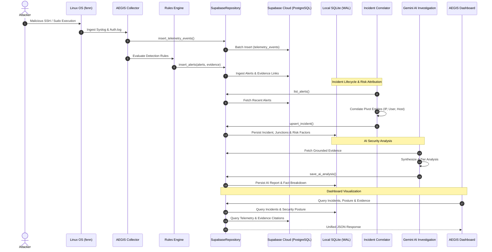

# AEGIS Database Architecture Specification

**Status:** APPROVED FOR HYBRID / TARGET SSoT SPECIFIED  
**Date:** 2026-11-08  
**Author:** Apri (Senior Cybersecurity Engineer & Full-Stack Platform Architect)  
**System:** AEGIS (AI-Powered Linux Security Monitoring & Incident Investigation)

---

## 1. Architectural Dilemma & Evaluation

AEGIS captures security events from Linux operating system telemetry, performs real-time detection, links forensic evidence, groups alerts into correlated incidents, calculates risk scores, and synthesizes AI investigation reports. This requires a persistent storage foundation that satisfies three mandatory operational criteria:

1. **Zero Data Loss:** Incidents, evidence, and audit findings must survive application crashes, VM reboots, and network outages.
2. **Low-Latency Analysis:** Correlating high-volume alerts and streaming AI analysis tokens requires rapid read/write cycles without blocking backend threads.
3. **Forensic Integrity:** Evidence linking and risk attribution must be cryptographically consistent and relational without orphan records.

To resolve the database foundation, two primary architectural paths and one hybrid model were evaluated:

### 1.1 Option A: Cloud Supabase PostgreSQL as Single Source of Truth (SSoT)

* **Architecture:** All tables (Telemetry, Alerts, Evidence, Incidents, AI Analyses, Security Checker) reside exclusively in Supabase Cloud PostgreSQL.
* **Advantages:**
  * **Unified Relational Model:** Native PostgreSQL foreign keys and complex SQL `JOIN`s link telemetry events, detection rules, alert evidence, incidents, and AI analyses within a single database engine.
  * **Multi-Node Fleet Scalability:** Centralized cloud storage enables monitoring hundreds of Linux agents reporting to a single console.
  * **Managed Cloud Durability:** Automated daily backups, point-in-time recovery (PITR), encryption at rest, and Supabase Row Level Security (RLS).
* **Disadvantages:**
  * **Network Latency:** REST queries over HTTPS introduce 450ms - 800ms roundtrip overhead per transaction.
  * **WAN Dependency:** If WAN or Cloudflare tunnels drop, local Linux agent telemetry ingestion and incident response are blocked.
  * **Migration Approval Barrier:** Requires executing DDL migrations (`002`, `003`, `004`) on the live production cloud database.

### 1.2 Option B: Local SQLite as Permanent Primary Database

* **Architecture:** All data is stored locally in `/home/ubuntu/aegis/data/aegis_incidents.db` on the Linux host.
* **Advantages:**
  * **Ultra-Low Latency:** Queries execute in under 2ms via shared memory and WAL mode.
  * **Air-Gapped & Offline Resilience:** Fully autonomous on the monitored host; zero external dependencies.
  * **Zero Cloud Operational Cost:** No hosted database quotas or PostgREST rate limits.
* **Disadvantages:**
  * **Relational Boundary Fragmentation:** Cannot execute atomic database transactions across local incidents and cloud telemetry without custom synchronization middleware.
  * **Concurrency Contention:** SQLite supports single-writer concurrency. Under high telemetry ingest bursts, write locking can introduce latency spikes.
  * **Decentralized Backup Burden:** Requires operating and monitoring local backup daemons on every monitored server.

### 1.3 Architectural Decision: The Resilient Hybrid Architecture

AEGIS adopts the **Resilient Hybrid Architecture**, structured in two distinct phases:

```mermaid
graph TD
    subgraph Phase 1: Current Resilient State (Pre-Cloud Approval)
        T1[Linux Telemetry & Rules Engine] -->|HTTPS REST| C1[(Supabase Cloud: 001 Schema)]
        I1[Incident Correlation & AI Engine] -->|ACID WAL <2ms| S1[(Local SQLite: v2 Schema)]
        SC1[Security Checker Agent] -->|Primary| S1
        SC1 -.->|PGRST205 Fallback Handled| C1
    end

    subgraph Phase 2: Target Unified State (Post-Cloud Approval)
        T2[Linux Telemetry & Rules Engine] -->|Batch Ingestion| C2[(Supabase PostgreSQL SSoT: 001-004)]
        I2[Incident Correlation & AI Engine] -->|Unified SSoT| C2
        SC2[Security Checker Agent] -->|Unified SSoT| C2
        S2[(Local SQLite Buffer)] -.->|Offline Ingest Buffer & Local Cache| C2
    end
```

* **Current Active Phase (Phase 1):**
  * **Supabase Cloud:** Authoritative store for `telemetry_events`, `hosts`, `alerts`, `alert_evidence`, and `system_status`.
  * **Local SQLite Store (`aegis_incidents.db`):** Authoritative store for `incidents`, `incident_alerts`, `incident_risk_factors`, `incident_timeline`, `incident_status_history`, `ai_analyses`, `security_check_runs`, and `security_findings`.
  * **Zero In-Memory Fallback:** When Supabase lacks tables (`PGRST205`), data is persisted directly to disk in SQLite. No in-memory lists exist.
* **Target Unified Phase (Phase 2 - Upon User Migration Approval):**
  * Apply Migrations `002`, `003`, and `004` to Supabase Cloud.
  * Execute data migration script to sync existing SQLite incidents and security check runs into Supabase PostgreSQL.
  * Supabase PostgreSQL becomes the authoritative Single Source of Truth (SSoT).
  * SQLite is retained on the agent as an **offline write-ahead buffer** and **local read cache** to guarantee zero downtime during network interruptions.

---

## 2. Component Data Flow Architecture

The following diagram illustrates data flow and persistence boundaries across the system:



---

## 3. Schema Alignment & Data Contract Consistency

To ensure seamless transition between SQLite (local) and PostgreSQL (cloud), the schema definitions across both engines have been architected with 100% data contract compatibility:

### 3.1 Entity Mapping Specification

| Entity | SQLite Column / Type | PostgreSQL (Supabase) Column / Type | Compatibility Guarantee |
| :--- | :--- | :--- | :--- |
| **Incident ID** | `id TEXT PRIMARY KEY` | `id TEXT PRIMARY KEY` | String UUID or prefixed slug (`INC-...`) |
| **Host Ref** | `host_id TEXT NOT NULL` | `host_id TEXT NOT NULL REFERENCES hosts(id)` | Matched on host identifier string |
| **Risk Score** | `risk_score INTEGER NOT NULL`| `risk_score INT NOT NULL DEFAULT 0` | Standard integer score (0 - 100) |
| **Risk Level** | `risk_level TEXT NOT NULL` | `risk_level VARCHAR(20) NOT NULL` | Values: `critical`, `high`, `medium`, `low` |
| **Status** | `status TEXT NOT NULL` | `status VARCHAR(20) NOT NULL` | Values: `new`, `investigating`, `contained`, `resolved`, `false_positive` |
| **Alert Junction**| `incident_alerts` (junction) | `incident_alerts` (junction) | `UNIQUE(incident_id, alert_id)` |
| **Timeline** | `incident_timeline` (items) | `incident_timeline` (items) | ISO-8601 timestamp + kind + metadata |
| **AI Analysis** | `ai_analyses` (facts, etc.) | `ai_analyses` (facts_json, etc.) | Serialized JSON arrays stored as TEXT / JSONB |
| **Security Run** | `security_check_runs` | `security_check_runs` | Run counters, version, summary JSON |
| **Security Finding**| `security_findings` | `security_findings` | `UNIQUE(run_id, check_id)` |

### 3.2 JSON Serialization Handling

In SQLite, complex structured objects (such as `facts`, `inferences`, `hypotheses`, `unknowns`, and `summary`) are stored in `TEXT` columns and serialized/deserialized transparently via `json.dumps()` and `json.loads()`.

In Supabase PostgreSQL, these fields are defined as native `JSONB`. Because PostgREST automatically encodes and decodes JSON objects in HTTP request/response payloads, the Python application layer receives identical dictionary/list structures regardless of which database engine handles the request.

---

## 4. ACID Guarantees & Concurrency Architecture

### 4.1 SQLite Concurrency & WAL Mode
* **Journal Mode:** Write-Ahead Logging (`WAL`). Multiple reader threads concurrently query incidents, timeline events, and security posture without blocking or waiting for writer threads.
* **Writer Protection:** Writes use an application-level mutex (`threading.Lock`) combined with a SQLite busy timeout of `5000ms`. If a write transaction encounters a lock, it waits up to 5 seconds before raising an exception.
* **Foreign Key Constraints:** `PRAGMA foreign_keys = ON;` is executed on every database connection. Cascading deletes (`ON DELETE CASCADE`) are enforced at the engine level for all incident child records (`incident_alerts`, `incident_timeline`, `ai_analyses`, `incident_risk_factors`, `incident_status_history`).

### 4.2 Supabase PostgreSQL Integrity & RLS
* **Transaction Isolation:** Read Committed (PostgreSQL default) with atomic multi-table stored procedures (Migration 002).
* **Least Privilege Access:** All tables enforce Row Level Security (RLS) with explicit grants restricted to `service_role` and `postgres`. Public, anonymous, and unauthenticated roles are explicitly revoked.
