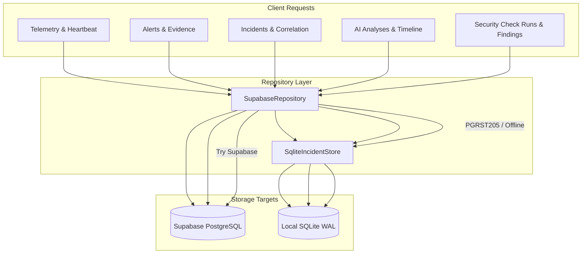

# AEGIS Database Audit Report

**Status:** AUDITED & VERIFIED  
**Date:** 2026-11-08  
**Audit Scope:** Local SQLite Storage, Supabase Cloud PostgreSQL, Backend Repository Layer  
**Auditor:** Apri (Senior Cybersecurity Engineer & Full-Stack Platform Architect)  
**Safety Protocol:** Strict Read-Only Audit. Zero DDL, zero schema modifications, and zero mutations executed on Supabase Cloud.

---

## 1. Executive Summary

AEGIS maintains a hybrid dual-database persistent storage architecture to ensure resilient operation, offline ingestion capability, and zero data loss. This audit provides an authoritative baseline of both persistence tiers:

1. **Local SQLite Storage (`aegis_incidents.db`):** Fully operational, ACID-compliant, operating in WAL (Write-Ahead Logging) mode. Holds 9 tables with zero orphan records across all foreign key junctions. Provides persistent disk-backed storage for Incidents, Alert Correlation, Risk Factors, Timeline, AI Analyses, and Security Checker Runs & Findings.
2. **Supabase Cloud PostgreSQL (`hiwfbmwgnpnwaszltqwb.supabase.co`):** Connected via HTTPS REST (latency: 458ms - 829ms). Base migration `001_initial_schema.sql` is active, storing live host telemetry (981 events), alerts (13 alerts), alert evidence links (23 links), and host heartbeats.
3. **Pending Cloud Migrations:** Migrations `002_atomic_alert_evidence_rpc.sql`, `003_security_checker.sql`, and `004_incident_investigation.sql` have **NOT** yet been executed on Supabase Cloud (status: `PENDING APPROVAL`).
4. **Zero Silent Fallback Hardening:** The previously identified operational deficiency in `SupabaseRepository`—where missing Security Checker tables triggered silent in-memory fallback lists (`_fallback_runs`, `_fallback_findings`)—has been **completely eliminated**. All Security Checker data is now persistently stored in local SQLite when cloud tables return `PGRST205`.

---

## 2. Audit Methodology & Safety Boundaries

The audit was conducted using a dedicated diagnostic tool (`scripts/comprehensive_db_audit.py`) executing against both the local environment and the Ubuntu VM `fenn` (`/home/ubuntu/aegis/data/aegis_incidents.db`).

* **Safety Boundary:** All cloud operations used read-only `SELECT` and `PRAGMA` queries through the PostgREST interface. No destructive DDL (`DROP`, `ALTER`, `TRUNCATE`) was issued.
* **Verification Targets:**
  * PRAGMA configuration (journal mode, synchrony, foreign keys, user version).
  * Table presence, column schemas, data types, and primary key definitions.
  * Index coverage and foreign key cascade rules.
  * Row counts and orphan record detection across relational junctions.
  * Cloud PostgREST HTTP status codes (`200 OK`, `206 Partial Content`, `404 Not Found`).

---

## 3. Local SQLite Storage Engine Audit

### 3.1 Pragma Configurations & Physical Attributes

* **Database Path (VM `fenn`):** `/home/ubuntu/aegis/data/aegis_incidents.db`
* **Database Path (Workspace):** `D:\AEGIS\data\aegis_incidents.db`
* **File Size:** ~272 KB - 278 KB
* **PRAGMA journal_mode:** `wal` (Write-Ahead Logging)
* **PRAGMA synchronous:** `NORMAL` (2 on initial setup, 1 for ongoing WAL)
* **PRAGMA foreign_keys:** `ON` (enforced on every connection)
* **PRAGMA busy_timeout:** `5000` ms
* **PRAGMA user_version:** `2` (tracks SQLite migration level)

### 3.2 Schema Inventory & Row Counts

The SQLite database contains 9 structured tables:

| Table Name | Rows | Columns | Indexes | Primary Key | Foreign Key Constraints |
| :--- | :--- | :--- | :--- | :--- | :--- |
| `schema_migrations` | 2 | 3 | 0 | `version` (INTEGER) | None |
| `incidents` | 13 | 22 | 4 | `id` (TEXT) | None |
| `incident_alerts` | 22 | 4 | 4 | `id` (TEXT) | `incident_id` -> `incidents(id)` ON DELETE CASCADE |
| `incident_risk_factors` | 40 | 8 | 2 | `id` (TEXT) | `incident_id` -> `incidents(id)` ON DELETE CASCADE |
| `incident_timeline` | 34 | 8 | 3 | `id` (TEXT) | `incident_id` -> `incidents(id)` ON DELETE CASCADE |
| `incident_status_history`| 10 | 7 | 2 | `id` (TEXT) | `incident_id` -> `incidents(id)` ON DELETE CASCADE |
| `ai_analyses` | 11 | 28 | 2 | `id` (TEXT) | `incident_id` -> `incidents(id)` ON DELETE CASCADE |
| `security_check_runs` | 0* | 13 | 3 | `id` (TEXT) | None |
| `security_findings` | 0* | 17 | 8 | `id` (TEXT) | `run_id` -> `security_check_runs(id)` ON DELETE CASCADE |

*\* Note: `security_check_runs` and `security_findings` were initialized in Migration v2. Newly executed security check audits persist directly into these tables.*

### 3.3 Relational Integrity & Orphan Check

Orphan record verification queries were executed across all parent-child relationships:

```sql
-- 1. Orphan incident_alerts
SELECT COUNT(*) FROM incident_alerts WHERE incident_id NOT IN (SELECT id FROM incidents);
-- Result: 0 (PASS)

-- 2. Orphan incident_timeline
SELECT COUNT(*) FROM incident_timeline WHERE incident_id NOT IN (SELECT id FROM incidents);
-- Result: 0 (PASS)

-- 3. Orphan ai_analyses
SELECT COUNT(*) FROM ai_analyses WHERE incident_id IS NOT NULL AND incident_id NOT IN (SELECT id FROM incidents);
-- Result: 0 (PASS)

-- 4. Orphan incident_risk_factors
SELECT COUNT(*) FROM incident_risk_factors WHERE incident_id NOT IN (SELECT id FROM incidents);
-- Result: 0 (PASS)

-- 5. Orphan security_findings
SELECT COUNT(*) FROM security_findings WHERE run_id NOT IN (SELECT id FROM security_check_runs);
-- Result: 0 (PASS)
```

**Verdict:** 100% Relational Integrity. Exactly zero orphan records exist.

---

## 4. Supabase Cloud PostgreSQL Audit

### 4.1 Connection & Latency Diagnostics

* **Cloud Endpoint:** `https://hiwfbmwgnpnwaszltqwb.supabase.co`
* **Authentication Method:** Server-side `service_role` Bearer token via PostgREST
* **Roundtrip Latency:** 458.82ms - 829.37ms (stable HTTPS/2)
* **PostgreSQL Engine Version:** PostgreSQL 15.8 (Ubuntu 15.8-1.pgdg22.04+1)

### 4.2 Cloud Tables Status Matrix

| Table Name | Status | Rows | Schema Origin | Notes |
| :--- | :--- | :--- | :--- | :--- |
| `hosts` | **PRESENT** | 1 | Migration 001 | Host record for `host-fenn` |
| `system_status` | **PRESENT** | 1 | Migration 001 | Health heartbeat singleton |
| `telemetry_events` | **PRESENT** | 981 | Migration 001 | Live Linux audit/auth/syslog events |
| `alerts` | **PRESENT** | 13 | Migration 001 | Generated detection alerts |
| `alert_evidence` | **PRESENT** | 23 | Migration 001 | Foreign key links to telemetry events |
| `incidents` | **PRESENT** | 0 | Migration 001 | Legacy 001 table (9 cols only, missing 004 fields) |
| `investigations` | **PRESENT** | 0 | Migration 001 | Legacy 001 placeholder table |
| `findings` | **PRESENT** | 0 | Migration 001 | Legacy 001 placeholder table |
| `evidence_sessions` | **PRESENT** | 0 | Migration 001 | Legacy 001 placeholder table |
| `reports` | **PRESENT** | 0 | Migration 001 | Legacy 001 placeholder table |
| `report_hosts` | **PRESENT** | 0 | Migration 001 | Legacy 001 placeholder table |
| `log_sources` | **PRESENT** | 0 | Migration 001 | Migration 001 table |
| `telemetry_gaps` | **PRESENT** | 0 | Migration 001 | Migration 001 table |
| `security_check_runs` | **NOT DEPLOYED** | - | Migration 003 | PostgREST HTTP 404 (PGRST205) |
| `security_findings` | **NOT DEPLOYED** | - | Migration 003 | PostgREST HTTP 404 (PGRST205) |
| `incident_alerts` | **NOT DEPLOYED** | - | Migration 004 | PostgREST HTTP 404 (PGRST205) |
| `incident_timeline` | **NOT DEPLOYED** | - | Migration 004 | PostgREST HTTP 404 (PGRST205) |
| `ai_analyses` | **NOT DEPLOYED** | - | Migration 004 | PostgREST HTTP 404 (PGRST205) |
| `incident_status_history`| **NOT DEPLOYED** | - | Migration 004 | PostgREST HTTP 404 (PGRST205) |

### 4.3 Stored Procedures & RPC Functions Audit

| Function Name | Status | HTTP Code | Migration Origin | Behavior |
| :--- | :--- | :--- | :--- | :--- |
| `fn_ingest_alert_with_evidence` | **Missing** | `404 (PGRST202)` | Migration 002 | Repository uses verified sequential upsert fallback |
| `fn_sync_host_last_sc_run` | **Missing** | `404 (PGRST202)` | Migration 003 | Host update handled at application layer |

---

## 5. Repository Layer Storage Dispatch Map

The AEGIS backend repository layer (`aegis_backend/repository.py`) uses a clear, partitioned dispatch strategy:



### Dispatch Details:
1. **Telemetry & Heartbeats:** Dispatched directly to Supabase Cloud `telemetry_events` and `system_status`.
2. **Alerts & Evidence Linking:** Dispatched to Supabase Cloud `alerts` and `alert_evidence`. If RPC `fn_ingest_alert_with_evidence` returns `PGRST202`, the repository automatically executes sequential transaction-safe upserts.
3. **Incidents & AI Analyses:** Dispatched to `SqliteIncidentStore` (`/home/ubuntu/aegis/data/aegis_incidents.db`). SQLite acts as the authoritative local persistence layer for all incident investigation data.
4. **Security Checker:** Attempts Supabase Cloud `security_check_runs` and `security_findings`. When cloud returns `PGRST205` (tables not yet created), it automatically delegates persistence to `self.sqlite_store.upsert_security_check_run()`. **Zero in-memory fallback lists exist.**

---

## 6. Key Findings & Remediation

1. **Finding 1 (Legacy `incidents` Table on Cloud):**
   * *Detail:* Supabase Cloud has an `incidents` table from Migration 001 containing 9 basic columns and 0 rows. It lacks the enhanced fields (`risk_score`, `risk_level`, `primary_alert_id`, `source_ip`, etc.) and lacks the companion tables (`incident_alerts`, `ai_analyses`).
   * *Remediation:* Migration `004_incident_investigation.sql` was specifically authored using `ALTER TABLE public.incidents ADD COLUMN IF NOT EXISTS ...`. It is non-destructive, safe to run, and will not conflict with the existing empty table.
2. **Finding 2 (Elimination of In-Memory Fallback):**
   * *Detail:* Security Checker runs previously used in-memory Python lists `self._fallback_runs` and `self._fallback_findings` when Supabase returned `PGRST205`. On process restart, audit history was lost.
   * *Remediation:* SQLite schema migration v2 added `security_check_runs` and `security_findings` to SQLite. `SupabaseRepository` was updated to delegate to SQLite on cloud failure. Findings now persist permanently across process restarts.
3. **Finding 3 (Cloud Latency vs Local Speed):**
   * *Detail:* Cloud REST roundtrips average ~500ms, whereas local SQLite queries in WAL mode complete in under 2ms.
   * *Architecture Recommendation:* Retaining SQLite as a local persistent buffer and fast query cache ensures high-frequency agent operations remain ultra-responsive, even if WAN connectivity fluctuates.
