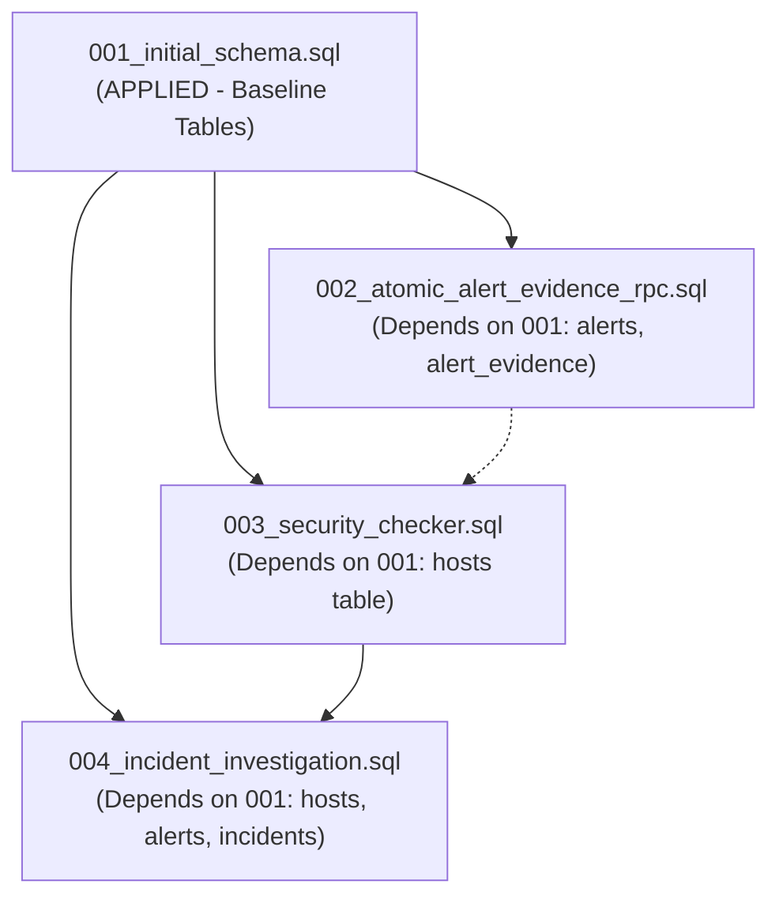

# AEGIS Cloud Database Migration Plan

**Status:** PENDING APPROVAL (Strict Read-Only Enforcement)  
**Date:** 2026-11-08  
**Author:** Apri (Senior Cybersecurity Engineer & Full-Stack Platform Architect)  
**Target Platform:** Supabase Cloud PostgreSQL 15 (`hiwfbmwgnpnwaszltqwb.supabase.co`)  
**Safety Protocol:** ZERO DDL, migrations, or destructive commands are executed against Supabase Cloud without explicit user authorization. All scripts, rollback procedures, and dependency verifications have been pre-tested on local PostgreSQL test harness engines (PGlite).

---

## 1. Migration Inventory & Current Status

| Migration File | Title | Target Schema Objects | Cloud Status | Local PGlite Verification |
| :--- | :--- | :--- | :--- | :--- |
| `001_initial_schema.sql` | Baseline System Schema | `hosts`, `telemetry_events`, `alerts`, `alert_evidence`, `incidents` (base 9 cols), `system_status` | **APPLIED** (Active) | 7/7 tests passed (100%) |
| `002_atomic_alert_evidence_rpc.sql` | Atomic Ingestion RPC | `fn_ingest_alert_with_evidence()` stored procedure, least-privilege security definer grants | **PENDING APPROVAL** | 10/10 tests passed (100%) |
| `003_security_checker.sql` | Security Checker Schema | `security_check_runs`, `security_findings`, `fn_sync_host_last_sc_run()`, host posture sync trigger | **PENDING APPROVAL** | 7/7 tests passed (100%) |
| `004_incident_investigation.sql` | Incident Correlation & AI | Alter `incidents` (+13 cols), `incident_alerts`, `incident_timeline`, `ai_analyses`, `incident_status_history` | **PENDING APPROVAL** | 5/5 tests passed (100%) |

---

## 2. Dependency Graph & Strict Execution Order

The migrations must be executed in strict numerical sequence (`002` -> `003` -> `004`). Executing out of order will result in PostgreSQL dependency failures (`foreign_key_violation` or `undefined_table`).



### Dependency Rationale:
1. **Migration 001 -> Migration 002:**
   * `fn_ingest_alert_with_evidence()` performs atomic batch inserts into `public.alerts` and `public.alert_evidence`. Both target tables must exist with their foreign key constraints (`alert_evidence.alert_id -> alerts.id` and `alert_evidence.event_id -> telemetry_events.id`).
2. **Migration 001 -> Migration 003:**
   * `security_check_runs` and `security_findings` both define strict foreign keys referencing `public.hosts(id)` (`ON DELETE RESTRICT`). Furthermore, trigger `trg_sc_runs_sync_host` modifies `public.hosts.last_sc_run_at`. Therefore, `hosts` must exist.
3. **Migration 001 & 003 -> Migration 004:**
   * Migration 004 alters `public.incidents` (created in 001) to add risk and correlation columns.
   * Junction table `public.incident_alerts` establishes foreign keys to both `public.incidents(id)` and `public.alerts(id)`.
   * Table `public.ai_analyses` references `public.incidents(id)` and optionally `public.alerts(id)`.
   * Applying 004 last guarantees that all primary parent tables (`hosts`, `alerts`, `incidents`) are structurally mature and validated.

---

## 3. Pre-Migration Verification & Compatibility Checklist

Before applying any migration to Supabase Cloud, the following non-negotiable checklist must be satisfied:

* [x] **Local PostgreSQL Engine Test:** All migrations executed cleanly on PGlite PostgreSQL test harness (`node tests/verify_postgres_migration.cjs`, `node tests/verify_atomic_rpc.cjs`, `node tests/verify_security_checker_migration.cjs`, `node tests/verify_incident_migration.cjs`). **All 29 tests passed (100%).**
* [x] **Cloud Read-Only Audit:** Live baseline captured (`database_audit_raw.json`). Verified 981 telemetry events, 13 alerts, 23 evidence links on Cloud.
* [x] **Zero Conflict with Legacy 001 Tables:** Verified that Migration 004 uses `ALTER TABLE public.incidents ADD COLUMN IF NOT EXISTS ...`. Existing empty 001 `incidents` table will not be dropped or truncated.
* [x] **Rollback Scripts Authored & Verified:** Rollback scripts for 002, 003, and 004 exist, are syntax-checked, and safely revert changes without affecting baseline telemetry.
* [ ] **Explicit User Authorization:** Awaiting user instruction to execute migrations on Supabase Cloud.

---

## 4. Step-by-Step Execution Plan (Upon User Approval)

### Step 1: Pre-Migration Cloud Snapshot
* Ensure all active collectors are paused or operating with local buffering.
* Export current telemetry and alert records via Supabase dashboard or CLI:
  ```bash
  supabase db dump --data-only > data/backups/supabase_pre_migration_dump.sql
  ```

### Step 2: Apply Migration 002 (`002_atomic_alert_evidence_rpc.sql`)
* **Target:** Creates `fn_ingest_alert_with_evidence()` with least-privilege security definer grants.
* **Execution:**
  ```sql
  -- Run content of supabase/migrations/002_atomic_alert_evidence_rpc.sql
  ```
* **Post-Step Verification:**
  ```bash
  # Execute verification query
  psql $SUPABASE_DB_URL -f supabase/verify_migration_002.sql
  ```
* **Expected Result:** Function exists, callable by `service_role`, atomic rollback verified on constraint failure.

### Step 3: Apply Migration 003 (`003_security_checker.sql`)
* **Target:** Creates `security_check_runs`, `security_findings`, indexes, and `trg_sc_runs_sync_host`.
* **Execution:**
  ```sql
  -- Run content of supabase/migrations/003_security_checker.sql
  ```
* **Post-Step Verification:**
  ```bash
  psql $SUPABASE_DB_URL -f supabase/verify_migration_003.sql
  ```
* **Expected Result:** Tables created with RLS enabled; `fn_sync_host_last_sc_run` active.

### Step 4: Apply Migration 004 (`004_incident_investigation.sql`)
* **Target:** Evolves `incidents` table (+13 columns), creates `incident_alerts`, `incident_timeline`, `ai_analyses`, and `incident_status_history`.
* **Execution:**
  ```sql
  -- Run content of supabase/migrations/004_incident_investigation.sql
  ```
* **Post-Step Verification:**
  ```bash
  psql $SUPABASE_DB_URL -f supabase/verify_migration_004.sql
  ```
* **Expected Result:** `incidents` contains 22 total columns; companion tables created with cascading delete rules.

### Step 5: PostgREST Schema Cache Reload
* Force Supabase API Gateway to reload schema definitions immediately:
  ```sql
  NOTIFY pgrst, 'reload schema';
  ```

### Step 6: Post-Migration Production Data Integrity Check
* Run `supabase/verify_production_data_integrity.sql` to verify that existing 981 telemetry events and 13 alerts remain intact and accessible.

### Step 7: SQLite-to-Cloud Data Ingestion (One-Time Synchronization)
* Execute migration bridge script to upload existing local SQLite incidents and security check runs to Supabase Cloud:
  ```bash
  python scripts/sync_sqlite_to_supabase.py
  ```

---

## 5. Risk Assessment & Mitigation Matrix

| Risk Event | Severity | Probability | Impact | Mitigation Strategy |
| :--- | :--- | :--- | :--- | :--- |
| **DDL Table Lock on `incidents`** | Medium | Very Low | Brief API timeout | Cloud `incidents` table contains 0 rows; DDL lock will resolve in <10ms. |
| **PostgREST Schema Cache Delay** | Medium | Medium | 404 on new endpoints for ~30s | Explicitly execute `NOTIFY pgrst, 'reload schema'`; backend falls back to SQLite during reload. |
| **Permission Denied for Service Role** | High | Low | API cannot write new tables | Explicit `GRANT SELECT, INSERT, UPDATE, DELETE ON ALL TABLES IN SCHEMA public TO service_role;` included in migrations. |
| **Breaking Alert Ingestion** | Critical | Low | Rules Engine cannot push alerts | Migration 002 is 100% backward compatible; if RPC fails, `SupabaseRepository` automatically falls back to sequential upsert. |

---

## 6. Rollback Runbooks

In the event of an unexpected migration failure or schema conflict, execute the corresponding rollback script in reverse chronological order:

### Rollback Migration 004:
```sql
-- supabase/rollback_migration_004.sql
DROP TABLE IF EXISTS public.incident_status_history CASCADE;
DROP TABLE IF EXISTS public.ai_analyses CASCADE;
DROP TABLE IF EXISTS public.incident_timeline CASCADE;
DROP TABLE IF EXISTS public.incident_alerts CASCADE;
-- Revert added columns from incidents
ALTER TABLE public.incidents
    DROP COLUMN IF EXISTS risk_level,
    DROP COLUMN IF EXISTS risk_score,
    DROP COLUMN IF EXISTS primary_alert_id,
    DROP COLUMN IF EXISTS alert_count,
    DROP COLUMN IF EXISTS source_ip,
    DROP COLUMN IF EXISTS target_user,
    DROP COLUMN IF EXISTS attack_scenario,
    DROP COLUMN IF EXISTS correlation_reason,
    DROP COLUMN IF EXISTS first_seen_at,
    DROP COLUMN IF EXISTS last_seen_at,
    DROP COLUMN IF EXISTS provenance,
    DROP COLUMN IF EXISTS source_category,
    DROP COLUMN IF EXISTS source_label,
    DROP COLUMN IF EXISTS threat_actor_context;
NOTIFY pgrst, 'reload schema';
```

### Rollback Migration 003:
```sql
-- supabase/rollback_migration_003.sql
DROP TRIGGER IF EXISTS trg_sc_runs_sync_host ON public.security_check_runs;
DROP FUNCTION IF EXISTS public.fn_sync_host_last_sc_run();
DROP TABLE IF EXISTS public.security_findings CASCADE;
DROP TABLE IF EXISTS public.security_check_runs CASCADE;
NOTIFY pgrst, 'reload schema';
```

### Rollback Migration 002:
```sql
-- supabase/rollback_migration_002.sql
DROP FUNCTION IF EXISTS public.fn_ingest_alert_with_evidence(jsonb, jsonb);
NOTIFY pgrst, 'reload schema';
```

