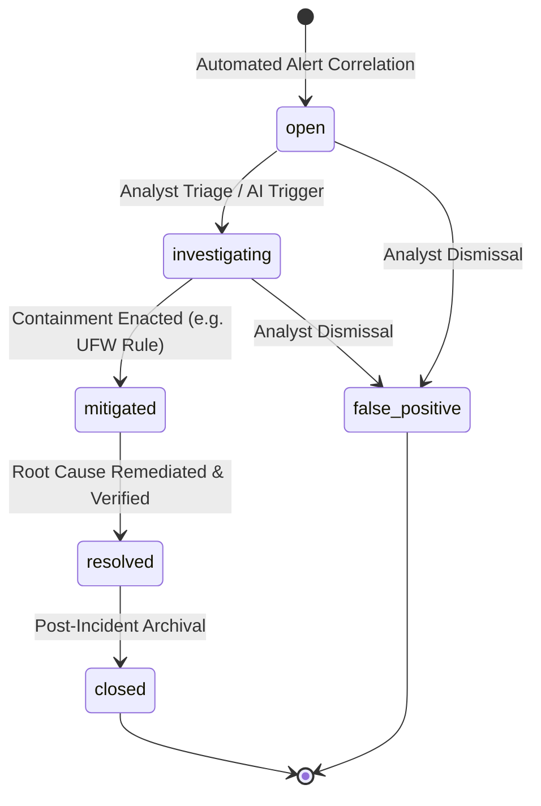

# AEGIS Incident Investigation & Lifecycle Operations

## 1. Incident Lifecycle Model
AEGIS models security incidents through a finite-state lifecycle with explicit transition safeguards and audit trails:

### State Definitions
| State | Label | Tone | Description |
| :--- | :--- | :--- | :--- |
| `open` | Open | Critical | Newly identified cluster of suspicious alerts awaiting analyst triage. |
| `investigating` | Investigating | High | Active forensic analysis in progress by analyst or automated AI agent. |
| `mitigated` | Mitigated | Warning | Immediate threat contained (e.g., ingress IP blocked, session killed). |
| `resolved` | Resolved | Healthy | System restored to verified secure state; root vulnerability fixed. |
| `closed` | Closed | Disabled | Incident investigation completed, report archived. |
| `false_positive` | False Positive | Disabled | Legitimate administrative activity or benign anomaly dismissed. |

## 2. Transition Auditing & History
Every status transition is immutably recorded in the `incident_status_history` table:
- `old_status`: Previous lifecycle state.
- `new_status`: Transitioned lifecycle state.
- `changed_by`: Operator username or automated agent identity.
- `notes`: Justification or operational context for the transition.
- `created_at`: Exact UTC timestamp.

## 3. Incident Forensic Context Composition
An AEGIS incident aggregates:
1. **Primary Alert:** The foundational detection that originated the incident.
2. **Correlated Secondary Alerts:** Associated alerts linked by temporal window (30m) or entity overlap.
3. **Grounded Supporting Evidence:** Specific normalized log records cited as proof.
4. **Security Posture Findings:** Local configuration deficiencies (e.g., inactive firewall, password authentication enabled).
5. **Timeline Stream:** Unified chronological sequence combining alerts, events, status changes, and AI analysis generations.

