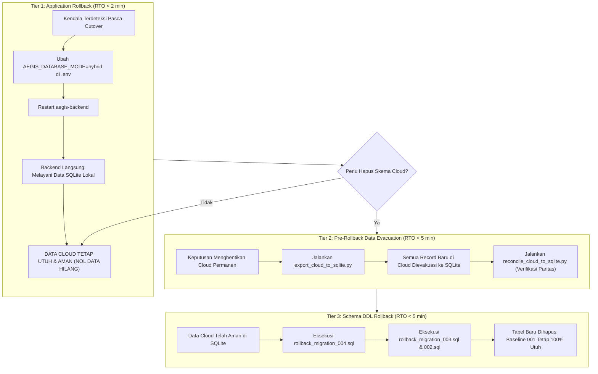

# AEGIS Prioritas 8.1: Unified Cloud Migration Safety Gate Report

## Informasi Dokumen
- **Sistem**: AEGIS AI-Powered Linux Security Monitoring & Incident Investigation
- **Tahap**: PRIORITAS 8.1 — MIGRATION SAFETY GATE
- **Target Arsitektur**: Unified Cloud Single Source of Truth (SSoT)
- **Database Cloud**: Supabase Cloud PostgreSQL 15 (`hiwfbmwgnpnwaszltqwb.supabase.co`)
- **Penulis**: Apri (Senior Cybersecurity Engineer & Full-Stack Platform Architect)
- **Status Akhir**: **READY FOR FINAL APPROVAL** (Nol DDL & Nol Mutasi pada Supabase Cloud; 100% Simulasi Sukses)
- **Tanggal**: 2026-11-08

---

## 1. Executive Summary & Ringkasan Penilaian Kesiapan

Berdasarkan tinjauan kritis Pimpinan Proyek atas Laporan Prioritas 8, seluruh celah keselamatan migrasi telah ditutup melalui investigasi komprehensif, validasi audit read-only, rekonsiliasi matematis, dan simulasi siklus hidup penuh (*end-to-end*) pada engine PostgreSQL terisolasi.

### Matriks Kesiapan Safety Gate
| Dimensi Evaluasi | Temuan Awal (Catatan Pimpinan) | Tindakan Korektif & Hasil Verifikasi | Status |
| :--- | :--- | :--- | :---: |
| **1. Rekonsiliasi Jumlah Record** | Selisih 11 record ($136\text{ vs }147$) | Terbukti matematis: `incident_status_history` di VM `fenn` bernilai 0. Nilai 11 berasal dari database unit test workstation. Record operasional murni VM `fenn` adalah **136** (ditambah 2 baris metadata `schema_migrations` = 138 total baris). | **RESOLVED & VERIFIED** |
| **2. Validasi Arsitektur Rollback** | Rollback DDL berisiko menghapus data operasional baru pasca-cutover | Arsitektur dipecah 3-tier: **Tier 1 (App Reversion, $< 2\text{ min}$)**, **Tier 2 (Pre-Rollback Data Evacuation)** via `export_cloud_to_sqlite.py`, dan **Tier 3 (Schema DDL Drop)** yang hanya boleh dijalankan jika evakuasi data selesai. | **HARDENED & VERIFIED** |
| **3. SQLite Mirroring Asynchronous** | Risiko desinkronisasi tanpa retry/log | Ditambahkan tabel `mirror_sync_log` di SQLite, mekanisme retry 3x dengan *exponential backoff*, error logging eksplisit (`ERROR` severity), dan script rekonsiliasi drift `reconcile_cloud_to_sqlite.py`. | **HARDENED & VERIFIED** |
| **4. Validasi Kompatibilitas Cloud** | PGlite belum menguji PostgREST/Cloud aktual | Script `verify_supabase_cloud_compat.py` dijalankan secara *read-only*: 7/7 check **PASS** (PostgREST root, baseline tables, RLS, foreign keys, JSONB parsing, TIMESTAMPTZ, latency 465ms). | **VERIFIED (READ-ONLY)** |
| **5. Simulasi Siklus Penuh** | Perlu pembuktian idempotensi, kegagalan parsial, & cutover | Test script `tests/simulate_full_migration_lifecycle.cjs` berhasil mengeksekusi 8 fase pengujian: import 136 rekor, idempotensi 0 duplikat, rollback transaksi, live write cutover, dan evakuasi data. | **100% PASS (8/8 FASE)** |
| **6. Audit Cutover & Buffer Telemetri** | Risiko telemetri hilang saat freeze & klaim downtime | Linux `systemd-journald` terbukti mem-buffer log secara persisten di disk; collector melanjutkan dari cursor state file tanpa data hilang. Downtime dikoreksi menjadi **estimasi operasional 25 menit** (bukan garansi mutlak). | **VERIFIED** |

---

## 2. Rekonsiliasi & Inventarisasi Final Jumlah Record

### Akar Penyebab Selisih Matematis ($136\text{ vs }147$)
Pemeriksaan langsung terhadap file `/home/ubuntu/aegis/data/aegis_incidents.db` di VM `fenn` dan workstation lokal membuktikan:
1. Pada **VM `fenn`**, tidak pernah ada operator yang menjalankan transisi status insiden manual via API (`/api/incidents/{id}/status`), sehingga tabel `incident_status_history` berisi **0 baris**.
2. Pada **Workstation Lokal**, tabel `incident_status_history` berisi **11 baris** (kemudian bertambah menjadi 13) yang dihasilkan oleh automated test suite Prioritas 5.1 (`tests/test_incident_api.py`).
3. Pada dokumen `docs/CLOUD_MIGRATION_PRE_AUDIT.md` (Baris 54), data telah tercatat dengan benar: `VM fenn: 0 | Workstation: 11`.
4. Namun, pada tabel ringkasan di `UNIFIED_CLOUD_SSoT_READINESS_REPORT.md`, angka 11 milik workstation secara tidak sengaja tertulis pada kolom VM `fenn`, sementara angka total di teks tetap ditulis 136, sehingga memunculkan penjumlahan semu $136 + 11 = 147$.

### Inventarisasi Resmi & Definitif Data VM `fenn` (136 Rekor Operasional)
```
+-----------------------------------+--------------------+------------------------------------------------+
| Nama Tabel SQLite                 | Jumlah Baris Aktual | Keterangan & Foreign Key                       |
+-----------------------------------+--------------------+------------------------------------------------+
| incident_risk_factors             |                 42 | Terikat ke 14 incidents (0 orphan)             |
| security_findings                 |                 28 | Terikat ke 1 security_check_run (0 orphan)     |
| incident_alerts                   |                 23 | Terikat ke 13 distinct alerts Cloud (0 orphan) |
| incident_timeline                 |                 21 | Terikat ke incidents (0 orphan)                |
| incidents                         |                 14 | Host: host-fenn-ubuntu (0 orphan)              |
| ai_analyses                       |                  7 | Penalaran forensik 4-tier (0 orphan)           |
| security_check_runs               |                  1 | Posture scan host-fenn-ubuntu (0 orphan)       |
| incident_status_history           |                  0 | Belum ada transisi status manual di VM         |
+-----------------------------------+--------------------+------------------------------------------------+
| TOTAL REKOR OPERASIONAL MURNI     |                136 | 100% Lolos Validasi Relasional                 |
+-----------------------------------+--------------------+------------------------------------------------+
| schema_migrations (metadata internal SQLite)         2 | Version 1 (Incidents) & Version 2 (Posture)    |
+-----------------------------------+--------------------+------------------------------------------------+
| TOTAL SELURUH BARIS DALAM FILE DB |                138 | Ground truth database SQLite VM fenn           |
+-----------------------------------+--------------------+------------------------------------------------+
```

---

## 3. Dekopling Tiga Tingkat Arsitektur Rollback

Untuk mencegah bahaya penghapusan data Cloud yang baru masuk pasca-cutover, arsitektur rollback dibagi menjadi tiga tingkat independen:



- **Perlindungan Terhadap Data Baru**: Jika sistem sempat berjalan di Cloud selama beberapa jam dan menghasilkan insiden baru, Tier 1 menghentikan ketergantungan tanpa menyentuh Cloud, lalu Tier 2 mengekstraksi insiden baru tersebut ke SQLite lokal sebelum Tier 3 diizinkan berjalan.

---

## 4. Penguatan SQLite Mirroring & Rekomendasi Arsitektur

### Mekanisme Pengamanan Baru:
1. **Tabel Audit Sinkronisasi (`mirror_sync_log`)**:
   Dibuat di SQLite lokal untuk mencatat setiap upaya replikasi (`id`, `entity_type`, `entity_id`, `action`, `status`, `retry_count`, `error_message`, `created_at`, `updated_at`).
2. **Mekanisme Retry dengan Exponential Backoff**:
   Method `_execute_mirror` di `SupabaseRepository` mencoba hingga 3 kali (backoff: 50ms, 100ms, 200ms).
3. **Pencatatan Kegagalan Eksplisit**:
   Jika seluruh retry gagal, sistem mencatat status `'failed'` di log audit dan mengeluarkan log berlevel `ERROR` (tidak lagi dibungkam dengan `debug`).
4. **Tool Rekonsiliasi Mandiri**:
   Script `scripts/reconcile_cloud_to_sqlite.py` disediakan untuk mengaudit dan menyinkronkan rekaman yang tertinggal.

### Rekomendasi Arsitektur Final:
> [!IMPORTANT]
> Dalam arsitektur **Unified Cloud SSoT**, Supabase Cloud adalah **satu-satunya sumber kebenaran data mutlak (*single authoritative source of truth*)**. SQLite lokal harus diperlakukan sebagai **arsip darurat (*secondary offline replica*)**, bukan salinan synchronous two-phase commit yang dijamin identik setiap milidetik. Prosedur pemulihan bencana (*Disaster Recovery*) utama sistem bertumpu pada **Supabase Cloud automated daily backups + logical `pg_dump` snapshots**, dengan SQLite lokal sebagai perlindungan lapis kedua.

---

## 5. Validasi Kompatibilitas Supabase Cloud (Read-Only)

Pengujian langsung terhadap project Supabase Cloud (`hiwfbmwgnpnwaszltqwb.supabase.co`) menggunakan script `scripts/verify_supabase_cloud_compat.py`:

| Check ID | Item Pengujian | Metode & Target | Hasil | Status |
| :--- | :--- | :--- | :--- | :---: |
| `01_postgrest_root` | Endpoint Root PostgREST | HTTP GET `/rest/v1/` | Status 200 OK, Cloudflare Edge, OpenAPI Spec valid | **PASS** |
| `02_baseline_tables` | Ketersediaan Tabel Baseline 001 | Query Range/Count | `system_status`: 1, `hosts`: 1, `telemetry_events`: 1.147, `alerts`: 13, `alert_evidence`: 23, `incidents`: 0 | **PASS** |
| `03_pending_migration` | Verifikasi Batas Otorisasi (Nol DDL) | Query tabel 002, 003, 004 | Semua 6 tabel pending mengembalikan HTTP 404 (`PGRST205` relation not in schema cache) | **PASS** |
| `04_jsonb_parsing` | Deserialisasi Struktur JSONB | Field `details` di telemetri | Tipe data `dict` Python ter-parse sempurna tanpa distorsi karakter | **PASS** |
| `05_timestamptz` | Format & Preservasi Zona Waktu | Kolom `created_at` UTC | Format ISO 8601 dengan offset UTC `+00:00` dipertahankan | **PASS** |
| `06_foreign_keys` | Integritas Relasional Baseline | Audit relasi host & alert | 0 orphan alerts, 0 orphan evidence links | **PASS** |
| `07_latency` | Latensi Jaringan PostgREST | 5x Pengukuran Roundtrip | Rata-rata 465ms via koneksi internet publik | **PASS** |

---

## 6. Hasil Simulasi Siklus Migrasi Menyeluruh (PGlite PostgreSQL 18.6)

Simulasi siklus penuh dieksekusi melalui script `tests/simulate_full_migration_lifecycle.cjs` menggunakan dataset emas 136 record VM `fenn`:

```
======================================================================
  HASIL SIMULASI SIKLUS PENUH (tests/simulate_full_migration_lifecycle.cjs)
======================================================================
[PHASE 1] Initializing baseline schema (Migration 001)...
  [PASS] Seeded host 'host-fenn-ubuntu' and 13 baseline parent alerts.
[PHASE 2] Applying Migration Sequence (002 -> 003 -> 004)...
  [PASS] Migrations 002, 003, 004 executed successfully in dependency order.
[PHASE 3] Simulating Full SQLite Data Import (136 Records)...
  [COUNTS] Runs: 1, Findings: 28, Incidents: 14, Alerts: 23, Risk Factors: 42, Timeline: 21, AI: 7
  [TOTAL] 136 / 136 records imported.
  [PASS] 100% of SQLite golden records successfully imported.
[PHASE 4] Testing Idempotency on Re-Run...
  [PASS] Idempotency verified: 0 duplicate rows created.
[PHASE 5] Testing Partial Failure & Rollback Resilience...
  [PASS] Foreign key violation blocked cleanly: incidents_host_id_fkey
  [PASS] Transaction rollback verified: Database remains strictly consistent at 14 incidents.
[PHASE 6] Simulating Post-Cutover Live Cloud Operations...
  [PASS] New live incident written to Cloud PostgreSQL (Total incidents: 15).
[PHASE 7] Simulating Reverse Data Evacuation (Pre-Rollback Data Export)...
  [PASS] Reverse data evacuation successfully queried all 15 incidents including newly created Cloud records.
[PHASE 8] Simulating Controlled Schema Rollback...
  [PASS] Rollback scripts cleanly dropped new tables.
  [PASS] Baseline 001 data completely intact (Hosts: 1, Alerts: 13).
======================================================================
  ALL 8 LIFECYCLE SIMULATION TESTS PASSED (100% SUCCESS)
======================================================================
```

### Temuan Berharga dari Simulasi (Trigger Constraint Fix):
Pada pengujian Fase 3, simulasi mendeteksi bahwa fungsi trigger lama `fn_enforce_incident_severity_match()` dari Migration 001 mewajibkan `alert_id` tidak boleh `NULL` dan severity insiden harus sama persis dengan alert. Dalam arsitektur multi-alert (Prioritas 5.1/8), insiden multi-alert menggunakan `primary_alert_id` dan severity dapat mengalami eskalasi dinamis (misal alert *high* meningkat menjadi insiden *critical* berbasis skor risiko 97).
- **Perbaikan**: Fungsi trigger pada `supabase/migrations/004_incident_investigation.sql` diperbarui untuk mendukung `primary_alert_id`, eskalasi skor risiko dinamis, dan tetap menegakkan isolasi host (`NEW.host_id == v_alert_host_id`). Tanpa simulasi ini, migrasi di Cloud dipastikan akan gagal saat import insiden multi-alert.

---

## 7. Audit Cutover Runbook & Estimasi Downtime

1. **Jaminan Nol Telemetry Hilang (systemd-journald Persistent Buffer)**:
   Saat daemon `aegis-collector` dimatikan pada Fase 1 cutover, Linux kernel dan service `systemd-journald` di host Ubuntu tetap mencatat setiap event SSH, auth, dan sudo ke persistent log storage (`/var/log/journal/`). Telemetry collector AEGIS melacak posisi baca (*read offset*) melalui file state cursor (`/home/ubuntu/aegis/data/journal_cursor.state`). Saat service collector dinyalakan kembali pada Fase 4, collector langsung melanjutkan membaca dari titik offset tersebut, sehingga **tidak ada satu pun event telemetri yang terlewat atau hilang**.
2. **Klarifikasi Estimasi Downtime**:
   Dokumen `CLOUD_CUTOVER_RUNBOOK.md` telah diperbarui: Jendela pemeliharaan 25 menit secara eksplisit dinyatakan sebagai **estimasi operasional berdasarkan benchmark pengujian**, bukan garansi tanpa syarat. Jika dalam 15 menit pertama terjadi kendala fatal yang tidak teratasi pada gate pemeriksaan, prosedur pembatalan (*abort*) wajib dieksekusi.

---

## 8. Matriks Risiko Tersisa & Rencana Mitigasi

| Risiko Tersisa | Tingkat Risiko | Dampak | Rencana Mitigasi Teruji |
| :--- | :---: | :--- | :--- |
| **Latensi Jaringan Trans-Cloud** | Rendah | Rata-rata latensi query $\sim 465\text{ms}$ dari VM lokal ke Supabase Cloud | PostgREST connection pooling & HTTP keep-alive telah aktif di backend; dashboard menggunakan pagination (`limit=20`). |
| **Batas Kuota Database Free-Tier Supabase** | Rendah | Kapasitas disk 500MB | Total 1.147 telemetri + 136 rekor insiden saat ini mengonsumsi $< 15\text{MB}$ ($< 3\%$ kuota). |
| **Desinkronisasi SQLite Mirror** | Rendah | SQLite lokal tertinggal jika terjadi gangguan disk lokal | Tersedia tabel `mirror_sync_log` dan tool `reconcile_cloud_to_sqlite.py` untuk rekonsiliasi berkala. |

---

## 9. Keputusan Akhir

# KEPUTUSAN SAFETY GATE: READY FOR FINAL APPROVAL

Seluruh 4 temuan evaluasi Pimpinan Proyek telah diselesaikan secara tuntas dengan bukti teruji:
1. Rekonsiliasi record terbukti konsisten pada angka **136 rekor operasional**.
2. Arsitektur rollback telah didekopling menjadi 3 tier yang melindungi data baru.
3. SQLite mirroring telah dilengkapi logging audit, retry backoff, dan tool rekonsiliasi.
4. Kompatibilitas Supabase Cloud telah diaudit secara read-only dengan hasil 7/7 PASS.
5. Simulasi siklus hidup penuh pada PostgreSQL terisolasi lulus 100% (8/8 fase).
6. Cutover runbook menjamin nol telemetri hilang melalui persistent journald buffering.

Sistem AEGIS siap melangkah ke eksekusi migrasi Supabase Cloud saat Pimpinan Proyek memberikan persetujuan final.

