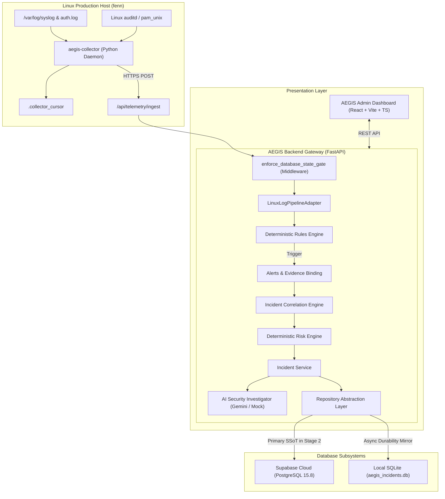

# AEGIS — Final System Architecture Specification

**Version:** 1.0.0 (Release Candidate)  
**Author:** Apri (Senior Software Engineer, Backend & Security Architect)  
**Classification:** Technical Architecture Standard  
**Target Host:** Linux Ubuntu 24.04 LTS (`fenn` / `192.168.193.129`)  

---

## 1. System Vision & Purpose

AEGIS is an AI-powered Linux security monitoring and incident investigation system. It bridges the gap between raw, high-volume operating system telemetry and actionable, evidence-grounded security investigations. 

Rather than relying on non-deterministic LLMs for primary detection or risk scoring, AEGIS implements a strict, multi-tiered pipeline:
1. High-throughput Linux systemd journal and audit log collection.
2. 100% deterministic security rules engine for threat detection.
3. Automated alert aggregation and forensic evidence preservation.
4. Entity-pivot and temporal incident correlation.
5. Deterministic multi-factor risk assessment.
6. AI-assisted root cause analysis and attack hypothesis generation, strictly grounded in verifiable evidence.
7. Real-time administrator visibility via a high-performance web dashboard.

---

## 2. End-to-End Data Pipeline Architecture



### Pipeline Execution Stages
1. **Host Event Collection:** `aegis-collector` reads Linux events from `journald` and `/var/log/auth.log`, maintaining persistent bookmark offsets in `.collector_cursor` across service reboots.
2. **Telemetry Ingestion & Normalization:** `LinuxLogPipelineAdapter` normalizes heterogeneous logs (SSHD failures, PAM session lifecycles, sudo command execution, curl/wget network spawns) into typed `TelemetryEvent` structures.
3. **Deterministic Detection:** `RulesEngine` evaluates sliding temporal windows. Threat signatures (e.g. `RULE-SSH-BRUTE`, `RULE-PRIV-001`) evaluate without external dependencies or LLM hallucination risk.
4. **Evidence Preservation:** Every generated `Alert` is cryptographically linked to the concrete `TelemetryEvent` IDs that triggered it in `alert_evidence`.
5. **Incident Correlation:** `IncidentCorrelator` clusters alerts occurring within temporal proximity (default 1800s) sharing pivotal entities (Source IP, Target User, Host ID) into an `Incident`.
6. **Deterministic Risk Scoring:** `RiskAssessmentEngine` calculates additive risk factors (Privilege Escalation, Brute Force, Off-Hours Activity, Known Bad Patterns) to assign a deterministic risk score (0–100) and risk level.
7. **Evidence-Grounded AI Investigation:** When an operator or workflow requests investigation, `IncidentContextBuilder` feeds observed events and facts into the AI provider. The AI provides root cause hypotheses, MITRE ATT&CK mapping, and containment advice, but is strictly forbidden from altering the deterministic risk score or referencing non-existent evidence IDs.
8. **Dashboard Presentation:** The React/TypeScript dashboard queries FastAPI endpoints to present incident timelines, security findings, host health, and telemetry streams.

---

## 3. Component Inventory & Responsibilities

| Component | Technology | Directory / Namespace | Primary Responsibility |
|---|---|---|---|
| **Collector Daemon** | Python 3.12 / systemd | `aegis_agent/collector.py` | Low-overhead log scraping, cursor checkpointing, batch HTTP delivery. |
| **Log Normalizer** | Python / Pydantic | `aegis_agent/pipeline_adapter.py` | Regex parsing, sanitization, deduplication, structured event generation. |
| **Rules Engine** | Python | `aegis_backend/rules_engine.py` | Temporal rule evaluation, alert deduplication, evidence linkage. |
| **Incident Correlator** | Python | `aegis_backend/incident_correlator.py` | Multi-alert clustering, pivot validation, contextual attribution. |
| **Risk Engine** | Python | `aegis_backend/risk_assessment.py` | Mathematical scoring (0–100), risk tier classification, posture factoring. |
| **AI Investigator** | Python / Gemini API | `aegis_backend/ai_provider.py` | Structured analysis, factual grounding, adversarial prompt rejection. |
| **Security Checker** | Python / CIS Benchmark | `aegis_agent/security_checker.py` | Linux CIS hardening assessment, system findings cataloging. |
| **State Machine** | Python | `aegis_backend/state_machine.py` | Database lifecycle gating, operational mode enforcement, fail-closed safety. |
| **Repository Layer** | Python / Supabase / SQLite | `aegis_backend/repository.py` | Abstracted persistence, background mirror replication, startup catch-up. |
| **Web Dashboard** | React 18 / Vite / TS | `dashboard/` | Real-time incident triage, evidence inspection, host monitoring. |

---

## 4. Database Ownership & Operational Modes

AEGIS supports two primary operational topologies governed by `AEGIS_DATABASE_MODE` in configuration:

### A. Hybrid Mode (`AEGIS_DATABASE_MODE=hybrid`)
- **Authority:** Local SQLite (`data/aegis_incidents.db`) is the authoritative primary database for incident management and security check runs.
- **Cloud Role:** Supabase Cloud receives streaming raw telemetry events (`telemetry_events`) and host registration heartbeats (`hosts`).
- **Use Case:** Initial baseline deployment, edge nodes with intermittent WAN connectivity.

### B. Cloud SSoT Mode (`AEGIS_DATABASE_MODE=cloud_ssot`)
- **Authority:** Supabase Cloud PostgreSQL 15.8 is the Single Source of Truth (SSoT) for all 13 database entities.
- **Local Role:** Local SQLite serves as a cold durability replica and disaster recovery backup. All Cloud writes are mirrored into SQLite asynchronously with an on-disk transaction log (`mirror_sync_log`).
- **Use Case:** Production deployment with unified central management and disaster recovery resilience.

---

## 5. Security & Trust Boundaries

```
[ Unstrusted External Network ]
             │
             ▼
[ Cloudflare Tunnel / Reverse Proxy (Apache) ]
             │
             ▼ TLS 1.3 (Strict Local Loopback 127.0.0.1:8000)
┌────────────────────────────────────────────────────────┐
│  AEGIS Backend Gateway (FastAPI)                       │
│  - enforce_database_state_gate (HTTP 503 Traffic Gate) │
│  - Session Authentication & Role Verification         │
│  - Input Sanitization & Parameter Validation           │
└────────────────────────────────────────────────────────┘
       │                                  │
       │ HTTPS / TLS 1.3 (service_role)   │ Local IPC / POSIX File IO
       ▼                                  ▼
┌─────────────────────────────┐   ┌──────────────────────────────┐
│ Supabase Cloud (PostgreSQL) │   │ Local SQLite Replica         │
│ - DAC: REVOKE ALL (anon)    │   │ (/home/ubuntu/aegis/data)    │
│ - RLS: Default Deny Active  │   │ - File mode 0600 (owner only)│
│ - Server-only via bypassrls │   │ - PRAGMA journal_mode=WAL    │
└─────────────────────────────┘   └──────────────────────────────┘
```

1. **Dashboard-to-Backend Boundary:** Browsers authenticate against FastAPI backend sessions. Browsers **never** receive Supabase service credentials and **never** connect to Cloud PostgreSQL directly.
2. **Backend-to-Cloud Boundary:** All Cloud communication uses encrypted HTTPS REST endpoints authenticated via `SUPABASE_SERVICE_ROLE_KEY`. Client roles (`anon`, `authenticated`) have zero database permissions.
3. **AI Context Boundary:** The AI prompt context is strictly filtered: passwords, private keys, and sensitive authorization headers are scrubbed by `aegis_backend/sanitizer.py` before prompt construction.
4. **Local File Permissions:** SQLite databases, collector cursors, and environment configuration files on host `fenn` are restricted to the `ubuntu` system account (`chmod 0600` / `chmod 0700`). Root privileges are required only for raw journal scraping.
