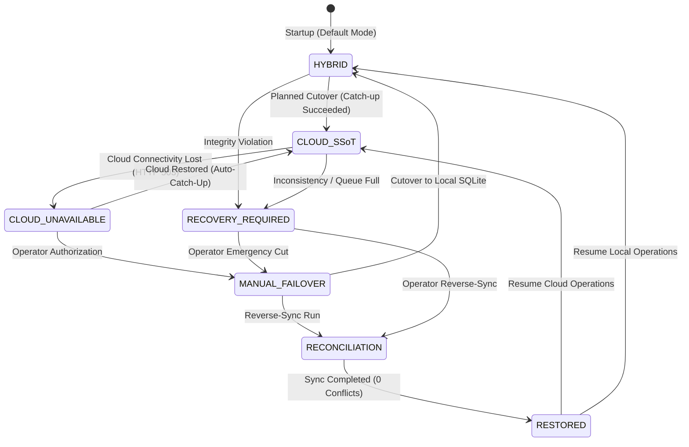

# AEGIS — Disaster Recovery, Outage Safety & Resilience Manual

**Version:** 1.0.0 (Release Candidate)  
**Author:** Apri (Senior Software Engineer, Database Architect, DevSecOps Lead)  
**Classification:** Disaster Recovery & High-Availability Standard  

---

## 1. Resilience Philosophy: Strict Fail-Closed

In distributed systems, the CAP theorem dictates that during a network partition, a system must choose between Consistency and Availability. AEGIS prioritizes **Data Integrity and Consistency** over silent, divergent availability.

When operating in `cloud_ssot` mode:
- **Strict Fail-Closed:** If Supabase Cloud becomes unreachable, AEGIS **does not** perform an automatic, silent failover to local SQLite.
- **Rationale:** Automatic failover during an uncoordinated outage creates a split-brain condition where local writes diverge from remote Cloud state, leading to silent data overwrites, colliding sequence numbers, and unresolvable foreign key orphans upon reconnection.
- **Traffic Gate Protection:** Mutating API calls (`POST`, `PUT`, `PATCH`, `DELETE`) are immediately blocked by `enforce_database_state_gate` with **HTTP 503 Service Unavailable**.

---

## 2. Rigorous Boundary Analysis: The "Unmirrored Crash" Outage

### A. The Edge-Case Failure Scenario
Consider the following chronological sequence of events:
1. $t_0$: An operator or automated pipeline submits a mutating request $M$ (e.g. incident creation or status change).
2. $t_1$: The backend submits $M$ to Supabase Cloud PostgreSQL.
3. $t_2$: Cloud PostgreSQL commits the transaction to persistent disk ($M \in S_{cloud}$).
4. $t_3$: Cloud returns `200 OK` / `201 Created` to the backend.
5. $t_4$: **Catastrophic crash:** Before the backend completes the asynchronous mirror write to SQLite or writes to the local queue disk file, host `fenn` experiences a kernel panic, sudden power loss, or hardware fault.
6. $t_5$: Concurrently, a wide-area network fiber cut or provider outage renders Supabase Cloud completely unreachable.
7. $t_6$: Host `fenn` boots back up while Cloud remains offline.

### B. Mathematical Proof of Durability Limits
- State in Cloud: $M \in S_{cloud}$
- State in SQLite: $M \notin S_{local}$
- State in Local Queue: $M \notin Q_{local}$
- Cloud Reachability: $P(\text{Cloud Online}) = 0$

**Consequence:**
Information $M$ exists **solely and exclusively** inside remote Cloud PostgreSQL. No byte of $M$ exists on host `fenn`. Therefore, it is physically and mathematically impossible for any local software on host `fenn` to reconstruct or recover $M$ while Cloud is unreachable.

### C. Architectural Honesty
> [!CAUTION]
> **No False Guarantees:** AEGIS explicitly rejects vendor claims of "zero data loss during catastrophic cloud outage after unmirrored crash". If the business chooses to force an emergency local failover while Cloud is hard-down, transaction $M$ will be absent from the local system until Cloud connectivity is restored and reconciliation is executed.

---

## 3. Database State Machine Lifecycle & States

The subsystem state machine (`aegis_backend/state_machine.py`) enforces strict deterministic state transitions:



### State Definitions
1. **`HYBRID`:** Local SQLite is authoritative. Cloud receives streaming telemetry. Normal operation for edge nodes.
2. **`CLOUD_SSoT`:** Supabase Cloud is authoritative SSoT. SQLite is cold mirror. Normal production operation in Stage 2.
3. **`CLOUD_UNAVAILABLE`:** Cloud unreachable. Mutating requests return HTTP 503. Read requests blocked to prevent stale divergence.
4. **`RECOVERY_REQUIRED`:** Consistency violation detected (e.g. catch-up failed, disk full). All mutations and reads locked. State persists across restarts in `data/.database_state.json`.
5. **`MANUAL_FAILOVER`:** Operator has explicitly authorized emergency cutover to SQLite, accepting delta gap risks.
6. **`RECONCILIATION`:** Active execution of `sync_cloud_to_sqlite.py` in progress. Mutations locked.
7. **`RESTORED`:** Reverse synchronization verified with 0 conflicts. Ready to transition to target operational state.

---

## 4. Disaster Recovery Runbooks

### Procedure 1: Automatic Recovery (Transient Cloud Outage)
When Cloud connectivity drops and recovers within reasonable timeframes:
1. Backend transitions from `CLOUD_SSoT` to `CLOUD_UNAVAILABLE` (mutations return HTTP 503).
2. The background mirror worker (`_periodic_mirror_worker`) detects Cloud restoration.
3. It replays any pending entries from SQLite table `mirror_sync_log`.
4. It executes `catch_up_unmirrored_from_cloud()` to reconcile any writes that occurred.
5. The state machine transitions back to `CLOUD_SSoT`, and HTTP 503 gate opens automatically.

### Procedure 2: Emergency Manual Failover to Local SQLite
If Cloud experiences a prolonged multi-hour outage and management decides that local incident investigations must proceed immediately:

1. **Verify Local Database Health:**
   ```bash
   ssh ubuntu@192.168.193.129
   sqlite3 /home/ubuntu/aegis/data/aegis_incidents.db "PRAGMA integrity_check;"
   # Must return: ok
   ```
2. **Execute State Machine Transition to MANUAL_FAILOVER:**
   ```bash
   curl -X POST http://127.0.0.1:8000/api/health/state/transition \
     -H "Content-Type: application/json" \
     -d '{"target_state":"MANUAL_FAILOVER","reason":"Management authorized emergency failover due to prolonged Cloud outage","operator":"sec_lead","force":true}'
   ```
3. **Switch Environment to Hybrid Mode:**
   ```bash
   sed -i 's/AEGIS_DATABASE_MODE=cloud_ssot/AEGIS_DATABASE_MODE=hybrid/' /home/ubuntu/aegis/.env
   sudo systemctl restart aegis-backend.service
   ```
4. **Verify Health Endpoint:**
   ```bash
   curl -s http://127.0.0.1:8000/api/health/database
   # Must return: {"database_mode":"hybrid","authoritative_database":"sqlite_local"}
   ```

### Procedure 3: Post-Outage Cloud Reconciliation
When Supabase Cloud recovers after an emergency manual failover:
1. Do **NOT** switch `.env` back to `cloud_ssot` immediately.
2. Run reverse synchronization dry-run to inspect deltas:
   ```bash
   python3 scripts/sync_cloud_to_sqlite.py --db-path data/aegis_incidents.db
   ```
3. If conflicts are detected, review `data/backups/conflict_report_*.json`.
4. Resolve conflicting timestamps or execute with `--force-cloud-wins` if Cloud remains primary.
5. Once resolved, switch `.env` back to `cloud_ssot` and restart `aegis-backend.service`.
