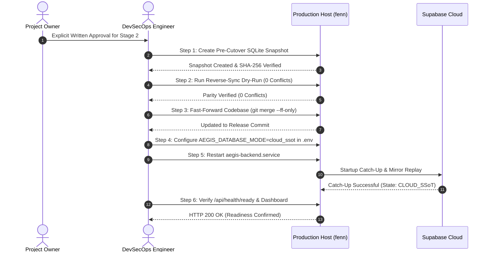

# AEGIS — Stage 2 Production Cutover Runbook (Unified Cloud SSoT)

**Document Version:** 1.0.0 (Release Candidate)  
**Author:** Apri (Senior Software Engineer, DevOps & QA Lead)  
**Target Host:** `192.168.193.129` (`fenn`)  
**Approval Gate:** **STAGE 2 EXPLICIT PROJECT OWNER APPROVAL REQUIRED PRIOR TO EXECUTION**  

---

## 1. Pre-Cutover Verification & Prerequisites

Do **NOT** begin execution until the following conditions are confirmed:
- [ ] Project Owner has provided explicit written approval for Stage 2 cutover.
- [ ] Candidate release commit is verified on `origin/main` (Commit `bfc616e` or newer).
- [ ] Supabase Cloud PostgreSQL 15.8 status is green (`https://hiwfbmwgnpnwaszltqwb.supabase.co`).
- [ ] Production services on `fenn` are active and stable (`aegis-backend.service`, `aegis-collector.service`).
- [ ] No active incident triage or manual database maintenance is currently in progress.

---

## 2. Production Cutover Execution Plan



---

## 3. Step-by-Step Command Execution

### Step 1: Create Pre-Cutover SQLite Snapshot on Production VM
Log into host `fenn` via SSH:
```bash
ssh ubuntu@192.168.193.129
cd /home/ubuntu/aegis

# Execute timestamped snapshot backup
python3 scripts/backup_sqlite.py --label stage2_pre_cutover
```
*Verification Check:*
```bash
ls -lh /home/ubuntu/aegis/data/backups/*stage2_pre_cutover*
# Ensure backup size is ~299 KB and .sha256 hash file exists.
```

### Step 2: Execute Pre-Cutover Reconciliation Verification
Validate that no unmirrored deltas exist between Cloud and SQLite before switching modes:
```bash
python3 scripts/sync_cloud_to_sqlite.py --db-path data/aegis_incidents.db
```
*Verification Check:*
Output must conclude with:
`>>> SUCCESS: DRY-RUN complete. (Would insert: 0, update: X, identical: Y). 0 records mutated. <<<`  
*(0 conflicts detected).*

### Step 3: Fast-Forward Production Codebase
Fetch and fast-forward merge the release commit from GitHub:
```bash
git fetch origin main
git rev-parse HEAD
# Expected current: 1e94c18d2574c4f8953eabc85f2ba8582b8724a6

git merge --ff-only origin/main
git rev-parse HEAD
# Expected new: Release commit hash (e.g. bfc616e...)
git status -s
# Working tree must be completely clean.
```

### Step 4: Configure Cloud SSoT Mode in Environment
Update `/home/ubuntu/aegis/.env` to activate Cloud SSoT:
```bash
# Append or update AEGIS_DATABASE_MODE
if grep -q "^AEGIS_DATABASE_MODE=" /home/ubuntu/aegis/.env; then
    sed -i 's/^AEGIS_DATABASE_MODE=.*/AEGIS_DATABASE_MODE=cloud_ssot/' /home/ubuntu/aegis/.env
else
    echo "AEGIS_DATABASE_MODE=cloud_ssot" >> /home/ubuntu/aegis/.env
fi

# Verify key exists without printing secrets
grep -o '^[^=]*' /home/ubuntu/aegis/.env | grep AEGIS_DATABASE_MODE
```

### Step 5: Restart Backend Service
Restart the backend service to activate the new configuration and trigger startup catch-up:
```bash
sudo systemctl restart aegis-backend.service
sleep 3
systemctl status aegis-backend.service --no-pager
```
*Verification Check:*
Backend process must be `active (running)`.

### Step 6: Verify Service Health & Readiness Probe
```bash
# 1. Readiness Probe (Traffic Gate)
curl -s http://127.0.0.1:8000/api/health/ready
# Expected: {"status":"ready","database_state":"CLOUD_SSoT","authoritative_database":"supabase_cloud"}

# 2. Database Detailed Health
curl -s http://127.0.0.1:8000/api/health/database
# Expected: {"status":"healthy","database_mode":"cloud_ssot","authoritative_database":"supabase_cloud","state_machine_state":"CLOUD_SSoT","is_mutation_allowed":true}

# 3. Incident Summary
curl -s http://127.0.0.1:8000/api/incidents/summary
```

---

## 4. Rollback Criteria & Emergency Abort Procedure

If any of the following failure triggers occur during cutover:
1. `aegis-backend.service` fails to start or crashes on startup.
2. `/api/health/ready` returns `HTTP 503` for longer than 60 seconds.
3. Supabase Cloud connection times out or rejects service credentials.
4. Data corruption or missing operational records reported by the dashboard.

**Immediate Rollback Procedure:**
```bash
# 1. Switch environment back to hybrid
sed -i 's/^AEGIS_DATABASE_MODE=.*/AEGIS_DATABASE_MODE=hybrid/' /home/ubuntu/aegis/.env

# 2. Restart backend
sudo systemctl restart aegis-backend.service

# 3. Verify hybrid recovery
curl -s http://127.0.0.1:8000/api/health/database
# Must report: {"database_mode":"hybrid","authoritative_database":"sqlite_local"}
```
*(Rollback completes in under 30 seconds with zero data loss).*

